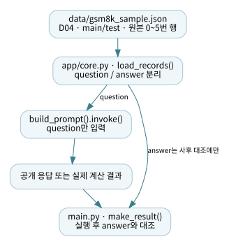

# 1차시 · 데이터 원본과 모델 입력을 구분하기

## 같은 문제를 비교하려면 먼저 입력을 고정한다

쇼핑몰의 매출이나 재고 수량을 설명하는 서비스에서도 수량을 잘못 해석하면 계산이 맞아도 업무 답은 틀릴 수 있다. 오늘은 문제와 수치 정답이 함께 있는 GSM8K로 입력 해석·계산·결과 대조를 분리한다. 원본은 영어 문장제다. 한국어 풀이를 요청하더라도 숫자·질문 원문을 바꾸지 않아 같은 문제를 비교할 수 있게 한다.

예를 들어 원본 0번 행은 하루 16개 달걀 중 아침 식사에 3개, 머핀에 4개를 쓰고 나머지를 개당 2달러에 판매하는 문제다. 수업용 한국어 요약이며 원문 번역 필드를 새 원본으로 만들지 않는다. 남은 수량은 `16-3-4=9`, 매출은 `9*2=18`이다. 16개 전체에 2달러를 곱하면 계산식의 문법은 맞아도 문제 해석이 틀린다.

| 원본 위치 | 수업용 ID | 확인할 수량 관계 | 원본 최종 답 |
| --- | --- | --- | --- |
| main/test 0행 | gsm8k-main-test-0000 | 남은 달걀 수 × 단가 | 18 |
| main/test 1행 | gsm8k-main-test-0001 | 파란 천 + 그 절반의 흰 천 | 3 |
| main/test 2행 | gsm8k-main-test-0002 | 가치 증가 후 매각가 − 전체 비용 | 70000 |
| main/test 3행 | gsm8k-main-test-0003 | 주당 횟수 × 회당 거리 | 540 |
| main/test 4행 | gsm8k-main-test-0004 | 하루 필요량 − 이미 준 양 | 20 |
| main/test 5행 | gsm8k-main-test-0005 | 정가 수량 + 할인 수량의 금액 | 64 |

행 번호는 0부터 센다. 파일의 여섯 항목은 원본 `main/test`의 처음 여섯 행이며 난이도 대표 표집이 아니다. 제공 목록의 다른 데이터나 임의 쇼핑몰 JSON을 사용한 것이 아니다.

## 작성 파일: app/core.py의 로더

`Path(__file__).resolve().parents[1]`은 `app/core.py`의 상위 프로젝트 폴더를 찾는다. 데이터 경로를 이 폴더에 붙여 실행 위치 때문에 엉뚱한 파일을 읽는 문제를 줄인다. 파일 내용은 JSON 문자열이며 `json.loads`가 이를 `list[dict]`로 바꾼다.

```python
def load_records():
    records = json.loads((ROOT / 'data/gsm8k_sample.json').read_text(encoding='utf-8'))
    if not records:
        raise ValueError('데이터가 비어 있습니다.')
    for row in records:
        if not all(isinstance(row.get(k), str) and row[k] for k in ('id', 'question', 'answer')):
            raise ValueError('id/question/answer 문자열이 필요합니다.')
    return records
```

`records[0]`은 첫 문제의 dict다. `records[0]["question"]`은 모델에 보낼 문자열이고 `records[0]["answer"]`는 실행 후 대조할 정답 설명이다. 로더는 필수 문자열이 있는지만 확인한다. 단위가 맞는지나 수학적으로 올바른지까지 자동 검증하는 함수는 아니다. 빈 배열과 필수 필드 누락은 `ValueError`로 일찍 알린다.

정답이 모델 입력에 섞이면 “문제를 풀었는가” 대신 “제공 정답을 복사했는가”를 비교하게 된다. 그래서 이후 모든 호출은 전체 row 대신 `row["question"]`만 넘긴다. 결과 저장 단계에서만 row를 다시 붙인다.



그림의 두 경로를 구분한다. question은 프롬프트를 거쳐 응답으로 이동하고, answer는 모델 호출을 건너뛰어 최종 대조 단계로 간다. `data/provenance.json`은 제공 데이터 ID·분할·행 번호·원본 필드·수업용 ID 생성 규칙을 담는다.

## 실행하고 원본 위치 확인

```bash
python main.py --session 1
```

터미널에 결과 HTML 경로가 나온다. 브라우저로 열면 원본 위치와 문제 원문이 표시된다. 상태는 `local_only`, 공급자와 모델은 `none`이다. API 호출은 발생하지 않는다. `--id gsm8k-main-test-0003`을 붙이면 같은 표본 안에서 선택 문제를 바꾼다.

`FileNotFoundError`가 나면 ZIP의 `data/gsm8k_sample.json`이 빠지지 않았는지 확인한다. 표본에 없는 ID는 명령행 오류로 종료한다. 결과 화면에 데이터 위치·행 번호·원문이 함께 보이는 부분을 캡처할 수 있다. 다음 차시에는 같은 question을 세 종류의 프롬프트에 넣는다.
