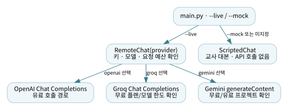

# 3차시 · 비용을 고려한 세 공급자 호출과 LCEL 연결

## 같은 계약으로 보내고 공급자별 형식만 바꾼다

전날 LCEL의 `|`는 앞 단계 결과를 다음 단계 입력으로 넘겼다. 오늘은 `ChatPromptTemplate → 메시지 목록 변환 → 채팅 호출`로 연결한다. 공급자는 OpenAI·Groq·Gemini 중 하나를 선택하며 세 곳에 동시에 전송하지 않는다. 일반 텍스트 대화만 공통 계약으로 잡고 공급자 고유의 native tool/strict schema를 공통 지원한다고 가정하지 않는다.

반복은 현재 계정에서 무료 사용이 확인된 Groq 또는 Gemini를 우선한다. OpenAI는 유료 비교·기능 확인에 소수 호출로 선택한다. Gemini도 무료/유료 프로젝트와 모델에 따라 다르다. 화면에 키를 출력하지 않고, 실패한다고 다른 유료 API로 자동 전환하지 않는다.



## app/providers.py: 설정과 요청 본문

아래 클래스의 세 부분을 순서대로 읽는다. `__init__`은 dotenv를 읽고 선택한 공급자의 키·모델을 확인한다. `prepare`는 URL·헤더·본문을 만들기만 하고 네트워크 요청은 하지 않는다. `extract`는 응답에서 공개 텍스트와 사용량을 꺼낸다. 마지막 `__call__`이 실제 HTTP 요청을 실행한다.

```python
class RemoteChat:
    def __init__(self, provider, max_calls=8, max_tokens=800):
        load_dotenv(ROOT / '.env', override=False)
        if provider not in ('openai', 'groq', 'gemini'):
            raise ValueError('provider는 openai/groq/gemini 중 하나입니다.')
        self.provider = provider
        prefix = provider.upper()
        self.key = os.getenv(prefix + '_API_KEY', '').strip()
        self.model = os.getenv(prefix + '_MODEL', '').strip()
        if not self.key or not self.model:
            raise ValueError(f'{prefix}_API_KEY 와 {prefix}_MODEL 설정이 필요합니다.')
        if not 1 <= max_calls <= 30 or not 128 <= max_tokens <= 4096:
            raise ValueError('호출 상한 1~30, 출력 상한 128~4096을 사용하세요.')
        self.max_calls, self.max_tokens = max_calls, max_tokens
        self.calls = 0
        self.metrics = []

    def prepare(self, messages):
        if self.provider == 'gemini':
            system = '\n'.join(m['content'] for m in messages if m['role'] == 'system')
            contents = [{'role': 'model' if m['role'] == 'assistant' else 'user',
                         'parts': [{'text': m['content']}]} for m in messages if m['role'] != 'system']
            url = 'https://generativelanguage.googleapis.com/v1beta/models/'
            url += parse.quote(self.model, safe='') + ':generateContent'
            return url, {'x-goog-api-key': self.key}, {
                'systemInstruction': {'parts': [{'text': system}]}, 'contents': contents,
                'generationConfig': {'maxOutputTokens': self.max_tokens}}
        base = 'https://api.openai.com/v1' if self.provider == 'openai' else 'https://api.groq.com/openai/v1'
        return base + '/chat/completions', {'Authorization': 'Bearer ' + self.key}, {
            'model': self.model, 'messages': messages, 'max_completion_tokens': self.max_tokens}

    def extract(self, data):
        if self.provider == 'gemini':
            candidates = data.get('candidates', [])
            if not candidates or candidates[0].get('finishReason') != 'STOP':
                raise ValueError('Gemini 응답 거절·잘림·빈 후보')
            parts = candidates[0].get('content', {}).get('parts', [])
            text = ''.join(p.get('text', '') for p in parts if not p.get('thought', False))
            usage = data.get('usageMetadata', {})
        else:
            choices = data.get('choices', [])
            if not choices or choices[0].get('finish_reason') != 'stop':
                raise ValueError('응답 거절·잘림·빈 후보: 출력 상한/모델 지원을 확인하세요.')
            text = choices[0]['message'].get('content') or ''
            usage = data.get('usage', {})
        if not text.strip():
            raise ValueError('공개 응답 텍스트가 비어 있습니다.')
        return text, usage

    def __call__(self, messages):
        if self.calls >= self.max_calls:
            raise CallLimit('명령 단위 호출 상한 도달; 자동 공급자 전환 없음')
        self.calls += 1  # 실패 요청도 호출 예산에 포함한다.
        url, headers, payload = self.prepare(messages)
        req = request.Request(url, data=json.dumps(payload).encode('utf-8'),
                              headers={**headers, 'Content-Type': 'application/json'}, method='POST')
        started = time.perf_counter()
        try:
            with request.urlopen(req, timeout=45) as response:
                data = json.load(response)
            text, usage = self.extract(data)
        except error.HTTPError as exc:
            # 응답 본문·요청 헤더를 출력하지 않아 키 노출을 피한다.
            retry = exc.headers.get('Retry-After', '없음')
            raise RuntimeError(f'HTTP {exc.code}; Retry-After={retry}; 설정/한도 확인 후 수동 재실행') from None
        except (error.URLError, TimeoutError):
            raise RuntimeError('연결 실패 또는 45초 타임아웃; 자동 재시도 없음') from None
        self.metrics.append({'seconds': round(time.perf_counter() - started, 3), 'usage': usage})
        return text
```

`provider.upper()`로 `groq`를 `GROQ`로 바꿔 `GROQ_API_KEY`·`GROQ_MODEL`을 읽는다. 선택하지 않은 공급자의 키는 요구하지 않는다. `.env`의 `override=False`는 터미널에 이미 설정한 환경변수를 덮어쓰지 않는다는 뜻이다.

`prepare`의 OpenAI·Groq 분기는 `messages`를 그대로 사용한다. `max_completion_tokens`는 응답 생성 상한이며 모델별 지원을 확인해야 한다. Gemini는 system을 `systemInstruction`으로 분리하고 assistant role을 `model`로 바꾼 `contents`를 만든다. `generationConfig.maxOutputTokens`로 상한을 전달한다. API 키는 Gemini에서도 URL 쿼리가 아니라 헤더에 넣는다.

`json.dumps(payload).encode("utf-8")`는 Python dict를 HTTP 본문 바이트로 바꾼다. 서버의 JSON은 `json.load(response)`로 다시 dict가 된다. 여기서 직렬화된 문자열과 실제 응답 텍스트를 혼동하면 줄바꿈이 `\n`처럼 남을 수 있다. 결과 패널에는 `extract`가 꺼낸 문자열을 넣는다.

`finish_reason=stop` 또는 Gemini의 `finishReason=STOP`이 아니면 완성 답으로 쓰지 않는다. 길이 제한·거절·빈 응답을 구분해 확인할 수 있게 오류를 남긴다. Gemini의 `thought=True` 파트는 공개 답으로 취급하지 않는다. 다른 공급자에서도 별도 reasoning 필드를 읽거나 저장하지 않는다.

호출 수는 요청 직전에 증가하므로 실패도 예산에 포함된다. 기본 최대 8회, 출력 상한 800토큰, 요청 타임아웃 45초다. 자동 재시도는 0회다. 추론 토큰을 포함하는 모델에서는 800토큰이 부족해 공개 답이 잘릴 수 있다. 그때 모델 지원과 비용을 확인하고 `--max-tokens 1600`처럼 명시적으로 조정한다. 요청 수 상한은 계정의 금액 상한을 대신하지 않는다.

## main.py: 공통 체인을 실행하기

```python
def run_strategy(row, strategy, chat, max_turns):
    before = len(chat.metrics)
    try:
        if strategy == 'react':
            output = run_react(row['question'], chat, max_turns)
        else:
            chain = build_prompt(strategy) | RunnableLambda(to_messages) | RunnableLambda(chat)
            text = chain.invoke({'question': row['question']})
            output = {'status': 'finished', 'text': text, 'events': []}
    except (ValueError, RuntimeError, CallLimit) as exc:
        output = {'status': 'error', 'text': str(exc), 'events': []}
    return make_result(row, strategy, chat, output, chat.metrics[before:])
```

`RunnableLambda(to_messages)`는 프롬프트 결과를 HTTP 메시지 dict로 바꾸고, `RunnableLambda(chat)`은 선택한 채팅 객체를 호출한다. `chain.invoke({"question": row["question"]})`만 모델 입력으로 넘기므로 원본 answer는 요청에 들어가지 않는다. ReAct는 이 한 번짜리 체인 대신 다음 차시의 반복 함수를 호출한다.

`before`는 이번 전략 이전의 사용량 항목 수다. 실행 후 `chat.metrics[before:]`만 가져오므로 한 RemoteChat 객체를 여러 전략에서 재사용해도 각 전략의 실측 사용량을 구분할 수 있다. 네트워크/파싱 오류는 error 결과로 저장하며 성공처럼 정답 비교하지 않는다.

## 실행: 대본과 실제 호출을 구분

```bash
python main.py --session 3 --strategy direct --mock
python main.py --session 3 --strategy summary --mock
python main.py --session 3 --strategy fewshot --mock
```

모의 결과는 교사 대본이므로 같은 숫자가 나와도 프롬프트 효과를 검증한 것이 아니다. 실제 비교는 같은 공급자·모델을 유지한 채 아래 명령의 strategy만 바꾼다.

```bash
python main.py --session 3 --strategy summary --live --provider groq
python main.py --session 3 --strategy summary --live --provider gemini
python main.py --session 3 --strategy summary --live --provider openai
```

위 세 명령은 **선택지**다. 모두 실행할 필요가 없고 OpenAI 명령은 유료다. 한 명령은 기본 1회 호출한다. `HTTP 401/403`은 키·권한, `400/404`는 본문·모델·엔드포인트, `429`는 사용량/요청 한도부터 확인한다. 다음 차시는 모델 없이 실행되는 계산기를 연결한다.
