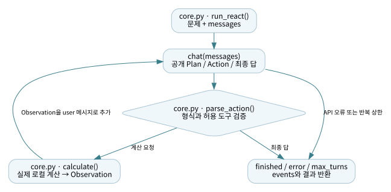

# 5차시 · 행동·관찰·최종 답을 잇는 ReAct 반복문

## 대화 이력에 무엇을 추가하는가

한 번짜리 프롬프트는 응답을 받으면 끝나지만 ReAct는 모델 응답을 읽고 실행이 필요한지 결정한다. 계산이 필요하면 로컬 계산 결과를 대화에 추가해 모델을 다시 호출한다. 프로그램이 도구를 실행하는 책임과 모델이 다음 행동을 제안하는 책임을 나눈다.



`run_react` 안의 핵심 상태는 `messages`와 `events` 두 목록이다. messages는 다음 모델 호출에 보낼 대화 이력이고 events는 화면에서 확인할 실행 기록이다. 도구 실행이 끝날 때 model 이벤트와 tool 이벤트가 별도로 남는다. API가 실패해도 이전에 실행한 도구 기록을 지우지 않는다.

## app/core.py: 직접 보이는 반복문

```python
def run_react(question, chat, max_turns=3):
    if not 1 <= max_turns <= 5:
        raise ValueError('max_turns는 1~5입니다.')
    messages = [{'role': 'system', 'content': REACT_SYSTEM}, {'role': 'user', 'content': question}]
    events = []
    for turn in range(1, max_turns + 1):
        try:
            text = chat(messages)
        except (RuntimeError, ValueError) as exc:
            return {'status': 'error', 'text': str(exc), 'events': events}
        events.append({'kind': 'model', 'turn': turn, 'text': text})
        messages.append({'role': 'assistant', 'content': text})
        try:
            expression = parse_action(text)
            if expression is None:
                return {'status': 'finished', 'text': text, 'events': events}
            value = calculate(expression)
            observation = f'계산식: {expression}\n결과: {value}'
            events.append({'kind': 'tool', 'turn': turn, 'text': observation})
        except (ValueError, SyntaxError, ArithmeticError) as exc:
            observation = f'도구/형식 오류: {exc}'
            events.append({'kind': 'tool_error', 'turn': turn, 'text': observation})
        messages.append({'role': 'user', 'content': 'Observation:\n' + observation})
    return {'status': 'max_turns', 'text': '반복 상한으로 중단: 최종 답 미완료', 'events': events}
```

처음에는 system 규약과 원본 question 두 개만 있다. `chat(messages)`로 받은 응답은 assistant 메시지로 추가한다. `parse_action(text)`의 반환이 None이면 최종 답이므로 `finished`로 종료한다. 계산식 문자열이면 calculate를 실제 호출한다.

관찰값은 `role="user"`의 `Observation:` 메시지로 넣는다. 오늘은 일반 텍스트 프로토콜이므로 native ToolMessage/tool_call_id를 사용하지 않는다. 이 차이를 무시하고 native 도구 API가 실행됐다고 설명하면 안 된다. 다음 호출은 이전 assistant의 Action과 프로그램의 Observation을 함께 본다.

| 시점 | messages의 내용 변화 | events의 변화 |
| --- | --- | --- |
| 시작 | system 규약, user 문제 | 비어 있음 |
| 첫 응답 | assistant Action 추가 | model 1회 |
| 실제 계산 후 | user Observation 추가 | tool 1회 |
| 두 번째 응답 | assistant 최종 답 추가 | model 2회 |
| 종료 | 더 호출하지 않음 | status=finished |

`max_turns=3`은 모델 응답 횟수 상한이다. 마지막 허용 회차에서 도구를 실행했더라도 최종 답을 받지 못하면 `max_turns`다. 18이라는 도구 값이 있다고 이를 모델의 완성 답으로 꾸미지 않는다. 모델이 도구 없이 바로 최종 답을 내면 허용하되 tool 이벤트가 없다는 사실이 기록된다. ReAct 프롬프트가 항상 실제 도구 사용을 보장하는 것은 아니다.

## 모의 모델은 어떻게 움직이는가

```python
class ScriptedChat:
    def __init__(self, record_id):
        self.expression, self.summary = FIXTURES[record_id]
        self.model, self.provider = 'teacher-script-v1', 'mock'
        self.calls, self.metrics = 0, []

    def __call__(self, messages):
        self.calls += 1
        system = messages[0]['content']
        value = calculate(self.expression)
        if 'Action: calculator' in system and not messages[-1]['content'].startswith('Observation:'):
            return f'Plan: 필요한 수량과 가격을 계산한다.\nAction: calculator\nAction Input: {self.expression}'
        if '풀이 없이' in system:
            return f'#### {value}'
        return f'계산: {self.expression} = {value}\n검증: {self.summary}\n#### {value}'
```

생성자는 `FIXTURES`에서 문제별 교사 작성 계산식과 요약을 받는다. 예를 들어 0번은 `(16-3-4)*2`다. 정답 `answer`를 읽어 모델 입력으로 넘기는 방식이 아니다. Action 이후 Observation 메시지가 오면 최종 답 형식으로 응답하는 대본이다. 이 대본 역시 calculate를 사용하므로 모든 정답 일치는 대본·프로그램 검증이며 모델 성능이 아니다.

```bash
python main.py --session 5 --mock
python main.py --session 5 --live --provider groq
```

두 번째 명령은 실제 호출 선택지다. 기본 흐름은 Action 1회 + Final 1회로 2번 호출하지만, 모델 응답에 따라 1~3회가 된다. 결과 HTML에서 `model → tool → model` 순서와 `tool`의 계산식·결과를 확인한다. 오류가 나면 tool_error가 기록되고 남은 회차 안에서 형식을 바로잡을 수 있다.

## 한 입력을 끝까지 추적하기

0행 question → 모델의 Action Input `(16-3-4)*2` → parse_action의 문자열 반환 → calculate의 `"18"` 반환 → Observation에 `결과: 18` 추가 → 다음 공개 응답 `#### 18` → 원본 answer의 최종 숫자 18과 대조한다. 중간 식은 모델의 선택이며 원본 정답에서 식을 읽어 자동 주입한 결과가 아니다.
