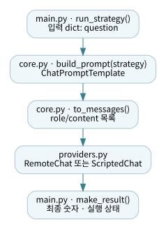

# 6차시 · 동일 문제에서 기본·풀이·ReAct 결과 비교

## 프롬프트 효과와 모델 차이를 분리한다

기본 응답과 짧은 풀이를 비교하려면 question·공급자·모델·표본 순서를 유지해야 한다. 공급자를 바꾸면 프롬프트뿐 아니라 모델·서비스 설정도 바뀐다. 이는 “구성 비교”이며 공급자만의 효과라고 해석할 수 없다. 오늘 필수 비교는 같은 공급자에서 direct·summary·react 세 방식이다. fewshot은 3차시에서 별도 선택 비교한다.

ReAct는 추가 호출과 계산 도구를 사용하므로 조건이 완전히 같은 단일 호출 실험은 아니다. 더 많은 자원을 써서 얻은 결과라는 차이도 함께 기록한다. 정답 여부만 보지 말고 호출 수·공개 응답·도구 실행·오류 상태를 함께 읽는다.



## 최종 숫자를 정규화하기

```python
def parse_final(text):
    # 마지막 줄의 #### 숫자만 허용: 단위·백분율은 수업 범위 밖이다.
    match = re.search(r'(?:^|\n)####\s+(-?\d[\d,]*(?:\.\d+)?)\s*$', text.strip())
    if not match:
        return None
    try:
        value = Decimal(match.group(1).replace(',', ''))
        return value if value.is_finite() else None
    except InvalidOperation:
        return None
```

문장에서 마지막 숫자만 무조건 가져오면 설명의 수량이나 날짜를 답으로 착각할 수 있다. 그래서 마지막 줄의 `#### 숫자`를 계약으로 정한다. 쉼표는 제거해 `70,000`과 `70000`을 같은 Decimal 값으로 비교한다. `#### 18원`은 이 코드에서 형식 실패이며 틀린 숫자 0으로 바뀌지 않는다. 숫자가 없는 응답과 수학 오답을 구별하려는 설계다.

원본 answer는 풀이와 최종 숫자가 함께 있는 문자열이다. 제공 표본은 literal `\n`을 사용하므로 사후 대조용 원본 answer에만 이를 실제 개행으로 복원한다. question이나 일반 응답 전체에 무차별 replace를 적용하지 않는다.

## main.py: 예측과 원본 정답 대조

```python
def make_result(row, strategy, chat, output, metrics=None):
    predicted = parse_final(output['text'])
    expected = parse_final(row['answer'].replace('\\n', '\n'))
    finished = output['status'] == 'finished'
    return {'record': row, 'strategy': strategy, 'mode': 'mock' if chat.provider == 'mock' else 'live',
            'provider': chat.provider, 'model': chat.model, **output,
            'predicted': str(predicted) if predicted is not None else None,
            'expected': str(expected) if expected is not None else None,
            'correct': bool(predicted == expected) if finished and predicted is not None and expected is not None else None,
            'metrics': metrics or []}
```

`predicted`는 모델의 공개 응답, `expected`는 원본 answer에서 추출한다. `status=finished`이며 두 값이 모두 있을 때만 bool로 일치 여부를 기록한다. 파싱 실패·API 오류·반복 중단은 `correct=None`이다. 이는 오류를 오답 숫자로 위장하지 않으면서 비교에서 미완료를 분리한다.

결과 객체에는 row가 들어가지만 이는 호출이 끝난 뒤 저장을 위한 것이다. 앞 단계 `chain.invoke`와 `run_react`에는 question만 들어갔다. 입력에 answer가 섞이지 않는 경계를 코드에서 다시 확인한다.

## 한 문제에서 시작한 후 표본을 늘리기

```bash
python main.py --session 6 --count 1 --mock
python main.py --session 6 --count 3 --mock
python main.py --session 6 --count 1 --live --provider groq
```

첫 두 명령은 구조 연습이다. 실제 호출은 마지막 명령이다. `--count 1`은 0행, `--count 3`은 0·1·2행을 의미한다. 6차시는 `--id`보다 count에 따른 앞쪽 표본 선택을 사용한다. 다른 행 하나만 실행하려면 3·5차시에서 `--id`를 쓴다.

| 설정 | 실제 API 요청 상한 계산 |
| --- | --- |
| 1문제 · max-turns=3 | direct 1 + summary 1 + react 최대 3 = 최대 5회 |
| 3문제 · max-turns=3 | 최대 15회, 기본 max-calls=8이면 그 전에 종료 가능 |
| 호출 예산을 명시적으로 확대 | `--max-calls 15`를 추가. 선택한 계정 한도와 비용 확인 필요 |

기본 max-calls는 명령 실행 전체에서 공유하는 8회다. 비용을 줄이기 위해 실제 비교는 1문제부터 시작한다. 여러 문제를 원격 실행하는 경우 요청 한도에 걸리면 오류 결과를 저장하고 중단한다. 재실행은 추가 호출이다.

HTML 상단에 비교 항목 수·숫자 파싱 수·정답 일치 수가 나온다. 미완료까지 포함한 전체 항목 수를 유지하고, 성공한 응답만 골라 정답률이 높아 보이게 만들지 않는다. 소수의 쉬운 문제나 모의 대본 결과를 “GSM8K 정확도” 또는 교육 효과라고 표현하지 않는다. 실제 결과가 나와야 모델별 수치를 작성할 수 있다.
