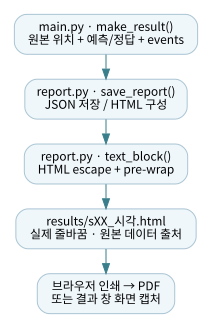

# 8차시 · 학습 근거가 남는 결과 HTML·PDF 만들기

## 결과만이 아니라 어떤 데이터로 만들었는지 남긴다

근거 화면에는 제공 데이터 D04·GSM8K 원본 링크·main/test·0부터 센 행 번호·원문 question이 함께 있어야 한다. 원본 ID가 없으므로 수업용 파생 ID 규칙도 밝힌다. 원본 answer는 실행 후 대조 영역에만 보여준다. 이렇게 해야 어떤 원본 문제를 어느 모델/방식으로 처리했는지 연결할 수 있다.

실제/모의 실행과 원본/가공 여부는 생략하지 않는다. 이번 표본은 원본 question/answer를 보존한 발췌본이다.



## app/report.py: 안전하게 실제 줄바꿈 표시

```python
def text_block(label, value):
    return f'<h3>{escape(label)}</h3><div class="result-text">{escape(str(value))}</div>'
```

`escape`는 `<script>` 같은 문자열이 HTML 태그로 실행되지 않고 글자로 보이게 한다. 실제 개행은 없어지지 않는다. `.result-text`에 다음 CSS를 적용하면 브라우저가 여러 줄과 빈 줄을 보존하면서 긴 문장을 자동으로 접는다.

```css
.result-text {
  white-space: pre-wrap;
  overflow-wrap: anywhere;
  line-height: 1.7;
}
@media print {
  .result-text {
    white-space: pre-wrap;
    overflow: visible;
    max-height: none;
  }
}
```

문자 그대로의 역슬래시+n은 CSS로 개행이 되지 않는다. 이 표본의 원본 answer는 알려진 저장 계약에 따라 그 필드의 표시 단계에서만 `replace('\\n', '\n')`를 적용한다. JSON으로 읽은 일반 응답은 다시 repr/JSON 문자열로 만들지 않고 바로 표시한다. 코드·경로·정규식에 원래 들어 있던 역슬래시를 전체 문서에서 바꾸지 않는다.

## 전체 저장 함수 읽기

```python
def save_report(session, results):
    folder = ROOT / 'results'
    folder.mkdir(exist_ok=True)
    stamp = datetime.now().strftime('%Y%m%d_%H%M%S_%f')
    stem = folder / f's{session:02}_{stamp}'
    stem.with_suffix('.json').write_text(json.dumps(results, ensure_ascii=False, indent=2), encoding='utf-8')
    cards = []
    for item in results:
        row = item['record']
        body = text_block('제공 데이터 위치', f'D04 · openai/gsm8k · config=main · split=test\n원본 행={row["row_index"]} (0부터) · 수업용 ID={row["id"]}\n원본 필드=question, answer; 수업용 ID는 파생값')
        body += text_block('원본 question', row['question'])
        body += text_block('방식 / 실행 모드', f'{item["strategy"]} / {item["mode"]}\n공급자={item["provider"]} · 모델={item["model"]} · 상태={item["status"]}')
        body += text_block('처리 결과', item['text'])
        for event in item.get('events', []):
            body += text_block(f'{event["turn"]}회 · {event["kind"]}', event['text'])
        body += text_block('정답 대조 (모델 입력에는 제외)', f'예측={item.get("predicted")} · 원본 정답={item.get("expected")} · 일치={item.get("correct")}')
        if item.get('metrics'):
            body += text_block('실측 API 사용량', json.dumps(item['metrics'], ensure_ascii=False, indent=2))
        # GSM8K answer는 이 표본에서 literal \n을 사용한다. 이 필드의 표시만 복원한다.
        body += text_block('원본 answer (표시용 개행 복원)', row['answer'].replace('\\n', '\n'))
        cards.append('<article>' + body + '</article>')
    comparable = [x for x in results if x['strategy'] != 'local']
    matched = sum(x.get('correct') is True for x in comparable)
    parsed = sum(x.get('predicted') is not None for x in comparable)
    summary = f'비교 항목 {len(comparable)}건 · 숫자 파싱 {parsed}건 · 정답 일치 {matched}건' if comparable else '로컬 구조 실습 · 모델 성능 비교 없음'
    html = f'''<!doctype html><html lang="ko"><meta charset="utf-8"><title>U2-02 실습 결과</title>
<style>{STYLE}</style><header><h1>2026-11-18 · CoT·ReAct 실습 결과</h1>
<p>제공 데이터: D04 GSM8K · <a href="{SOURCE}">{SOURCE}</a></p>
<p>{summary}</p><p>모의 대본의 정답 일치 수는 모델 성능 지표가 아닙니다. 소표본 결과를 GSM8K 전체 점수로 일반화하지 않습니다.</p>
<p>model=공개 응답 / tool=실제 로컬 계산 / mock=교사 작성 대본. 공개 풀이를 내부 사고 기록으로 해석하지 않습니다.</p></header>{''.join(cards)}</html>'''
    stem.with_suffix('.html').write_text(html, encoding='utf-8')
    return stem.with_suffix('.html')
```

`session`은 결과 파일 이름의 차시 번호이고 `results`는 make_result가 만든 dict 목록이다. 날짜·시각·마이크로초를 파일명에 넣어 재실행 결과를 구분한다. 같은 stem의 JSON은 다시 읽을 수 있는 구조화 기록이고 HTML은 브라우저에서 확인할 화면이다. 함수 반환값은 HTML 파일의 Path이며 HTML 문자열 자체가 아니다.

`row["row_index"]`·`row["id"]`는 제공 데이터 위치 영역에 들어간다. `events`의 kind가 tool이면 실제 calculate 반환 기록, model이면 공개 모델 응답이다. 모의 대본에서는 provider=mock임이 항상 드러난다. metrics는 실제 원격 요청의 seconds·usage이며 대본에서 가짜 지연/토큰을 만들지 않는다.

## main.py의 실행 진입점과 전체 분기

```python
def main():
    load_dotenv(ROOT / '.env', override=False)
    p = argparse.ArgumentParser(description='GSM8K CoT·ReAct 8차시 실습')
    p.add_argument('--session', type=int, choices=range(1, 9), required=True)
    p.add_argument('--id', default='gsm8k-main-test-0000')
    p.add_argument('--count', type=int, choices=range(1, 7), default=1)
    p.add_argument('--provider', choices=('openai', 'groq', 'gemini'), default=os.getenv('LLM_PROVIDER', 'groq'))
    mode = p.add_mutually_exclusive_group()
    mode.add_argument('--live', action='store_true')
    mode.add_argument('--mock', action='store_true')
    p.add_argument('--strategy', choices=('direct', 'summary', 'fewshot'), default='summary')
    p.add_argument('--max-turns', type=int, choices=range(1, 6), default=3)
    p.add_argument('--max-calls', type=int, choices=range(1, 31), default=8)
    p.add_argument('--max-tokens', type=int, default=800)
    p.add_argument('--input', type=Path)
    args = p.parse_args()
    rows = load_records()
    selected = next((row for row in rows if row['id'] == args.id), None)
    if selected is None: p.error('표본에 없는 ID입니다.')
    if args.session == 8:
        if args.input is None: p.error('--input results/파일.json 을 지정하세요.')
        items = json.loads(args.input.read_text(encoding='utf-8'))
        print(save_report(8, items))
        return
    if args.session in (1, 2, 4, 7):
        chat = ScriptedChat(selected['id'])
        if args.session == 1:
            text = f'표본 {len(rows)}개\n선택 ID: {selected["id"]}\nquestion만 모델 입력에 사용; answer는 실행 후 대조'
        elif args.session == 2:
            text = '\n\n'.join(strategy + '\n' + '\n'.join(m['role'] + ': ' + m['content'] for m in to_messages(build_prompt(strategy).invoke({'question': selected['question']}))) for strategy in ('direct', 'summary', 'fewshot'))
        elif args.session == 4:
            text = f'계산식: (16-3-4)*2\n실제 로컬 계산 결과: {calculate("(16-3-4)*2")}\n모델 호출 없음'
        else: text = failure_demo()
        items = [make_result(selected, 'local', chat, {'status': 'local_only', 'text': text, 'events': []})]
        items[0]['mode'], items[0]['provider'], items[0]['model'] = 'local_only', 'none', 'none'
    else:
        remote = RemoteChat(args.provider, args.max_calls, args.max_tokens) if args.live else None
        print(f'실행: {args.provider if args.live else "mock 교사 대본"}; '
              f'{"OpenAI 유료 호출" if args.live and args.provider == "openai" else "원격 호출은 계정 요금/무료 한도 확인 필요" if args.live else "API 호출 없음"}')
        items = []
        targets = rows[:args.count] if args.session == 6 else [selected]
        strategies = ('direct', 'summary', 'react') if args.session == 6 else ('react',) if args.session == 5 else (args.strategy,)
        for row in targets:
            for strategy in strategies:
                chat = remote if args.live else ScriptedChat(row['id'])
                item = run_strategy(row, strategy, chat, args.max_turns)
                items.append(item)
                print(row['id'], strategy, item['status'], item['predicted'])
                if item['status'] == 'error': break
            if items[-1]['status'] == 'error': break
    path = save_report(args.session, items)
    print('결과 HTML:', path)
```

`argparse`는 어떤 실습을 실행할지 선택한다. `parse_args()` 결과의 session 값이 1·2·4·7이면 로컬 코드만 실행한다. 3·5·6이면 live 여부에 따라 RemoteChat 또는 ScriptedChat을 생성한다. 8이면 이미 저장한 JSON을 다시 읽어 보고서만 만든다. 따라서 8차시 재출력 자체는 API 호출 비용이 없다.

원격 비교에서 RemoteChat 객체는 한 번 생성해 재사용하므로 max-calls가 모든 선택 문제와 전략에 걸쳐 합산된다. 모의 객체는 각 문제별 fixture를 사용한다. `if __name__ == "__main__": main()`은 파일을 실행했을 때만 이 분기 함수를 시작하며, 테스트에서 main 모듈을 import했다고 명령행 파싱이 자동 시작되지 않게 한다.

```bash
python main.py --session 6 --count 1 --mock
python main.py --session 8 --input results/s06_실제로생성된파일명.json
```

두 번째 명령의 파일명은 첫 실행에서 생긴 실제 JSON 이름으로 바꾼다. 예시 문자열을 그대로 실행하면 파일을 찾지 못한다. 생성된 HTML을 브라우저로 열고 원본 위치·question·처리 결과·tool 관찰·최종 답·실행 모드가 읽히도록 확인한다. 파일 메뉴의 인쇄에서 PDF 저장을 선택하고, 머리말/꼬리말의 로컬 경로 표시는 필요하면 끈다. 긴 결과가 다음 페이지까지 빠짐없이 출력되는지 미리보기에서 확인한다.

Windows에서는 결과 창을 연 뒤 Win+Shift+S로 해당 영역을 캡처해 `evidence/U2-02_D04_result.png`처럼 저장할 수 있다. 파일명은 수업용 제안이다. 실제 원격 API 근거가 필요하면 --live 결과를 캡처해야 한다. 포함된 예시 화면은 실제 로컬 계산과 교사 대본 모델의 결과 HTML을 PDF로 인쇄 렌더링한 것이며, 원격 API 성공 증빙을 대신하지 않는다.

## 다음 수업으로 이어지는 부분

오늘의 Action Input과 `#### 숫자`는 문자열 규약이라 형식 오류가 날 수 있다. 11월 19일에는 이 문제를 JSON 구조와 Pydantic 검증으로 연결한다. 오늘은 별도 강제 JSON 스키마나 native Function Calling 구현을 미리 넣지 않고, 메시지 생성·호출·계산·관찰·대조 경계를 이해한 상태로 넘긴다.
