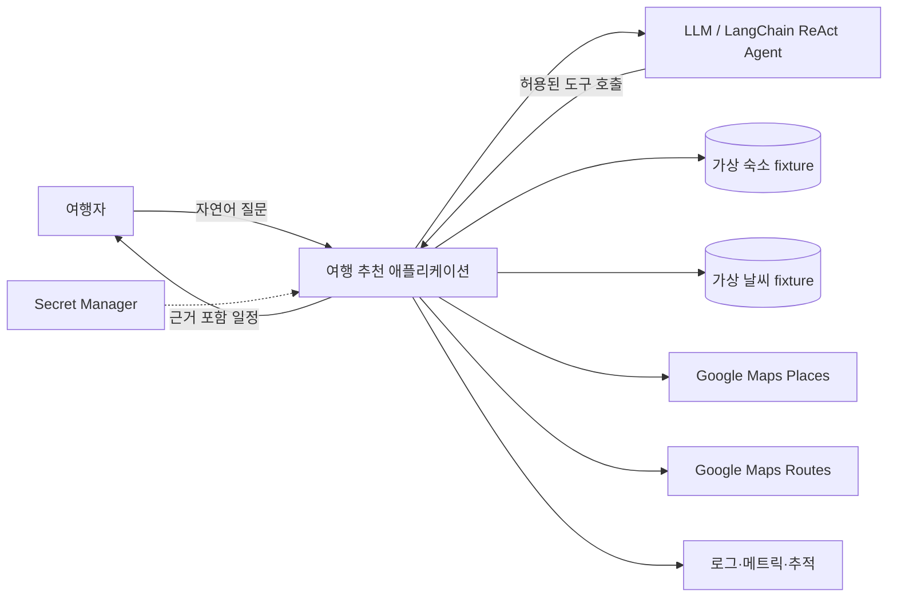
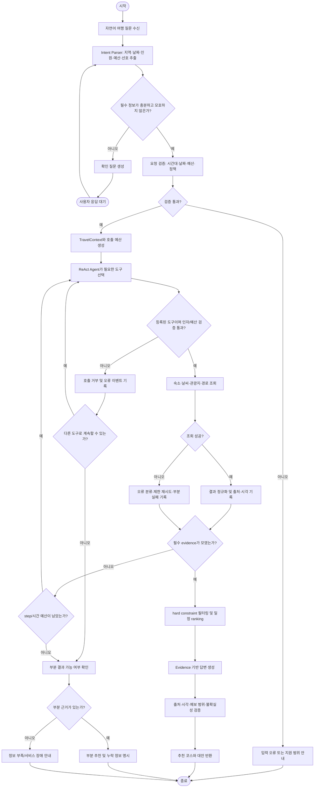
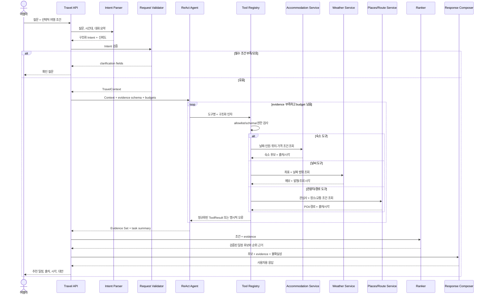

# 시스템 아키텍처

## 1. 설계 원칙

1. **의도 해석과 실행을 분리한다.** LLM은 자연어를 구조화된 `TravelIntent`로 바꾸고, 서버가 필수 값과 정책을 검증한다.
2. **ReAct는 제한된 도구만 사용한다.** 도구 이름, 인자 스키마, 호출 횟수, timeout을 서버가 관리한다.
3. **CoT는 내부 작업 방식이지 사용자 산출물이 아니다.** 비공개 chain-of-thought를 요구·저장하지 않는다. 검증 가능한 슬롯, 도구 호출, evidence, 추천 근거만 기록한다.
4. **사실은 도구 결과에서만 가져온다.** 가격·날씨·운영시간·이동 시간은 출처와 시각이 없으면 사실로 단정하지 않는다. 가상 데이터는 `simulated`로 표시한다.
5. **우선순위는 hard constraints → 예산순 ranking → 자연어 설명 순이다.** 생성 모델이 예산 초과나 날짜 불일치를 덮어쓰지 못하게 한다.
6. **실패는 명시한다.** 일부 공급자 장애는 부분 결과로 반환하고, 모든 근거가 없으면 추천을 생성하지 않는다.

## 2. 시스템 컨텍스트

LLM에는 DB 접속 정보나 API 키를 전달하지 않는다. Agent의 tool은 애플리케이션 서비스에 연결되며, 외부 시스템 요청은 해당 서비스만 수행한다. MVP 숙소/날씨는 가상 fixture이고, Google Maps Platform이 지도·장소·경로 provider다. 테스트는 Google Maps adapter를 mock으로 대체한다.

## 3. 논리 컴포넌트

| 컴포넌트 | 책임 |
|---|---|
| `Travel API` | 요청 검증, 인증/요청 ID 부여, 사용자 응답 및 오류 코드 반환 |
| `Intent Parser` | 질문을 구조화하고 필드별 신뢰도/모호성 평가 |
| `Clarification Manager` | 필수 슬롯 부족 시 질문 생성, 대화 상태 관리 |
| `Request Validator` | 날짜, 지역, 인원, 예산, 개인정보 및 정책 검증 |
| `Travel Agent` | LangChain ReAct 실행, 허용 도구 선택, step/cost/time 예산 적용 |
| `Tool Registry` | 각 도구의 이름·schema·권한을 고정 등록, 동적 임의 도구 호출 차단 |
| `Accommodation Service` | MVP 가상 숙소 fixture 조회, 향후 실데이터 repository adapter로 교체 |
| `Weather Service` | MVP 가상 날씨 시나리오 조회, 향후 실시간 예보 adapter로 교체 |
| `Places & Route Service` | Google Maps Platform으로 지역 해석, 장소·교통수단별 경로 조회 |
| `Evidence Store` | 한 요청 안에서 출처·조회시각·값을 보관; MVP는 요청 수명 범위 |
| `Itinerary Ranker` | 인원/지역/예산 위반 후보 제거, 숙박 총액 오름차순 정렬, 동률은 Google Maps 이동 시간으로 해소 |
| `Response Composer` | 근거와 제약에 맞는 사용자 답변 및 대안 구성 |
| `Provider Adapters` | LangChain 모델, 숙소 저장소, 날씨/지도 API의 공급자별 차이를 격리 |

## 4. Activity Diagram

## 5. Sequence Diagram

## 6. CoT와 ReAct의 역할 분리

- **CoT 단계:** 질문을 분석해 `TravelIntent`를 만들고, 필요 도구/필수 evidence를 간결한 JSON으로 제안한다. 자유 형식의 사고 과정은 외부로 출력하지 않는다.
- **검증 단계:** 서버가 누락값, 날짜 범위, schema, 예산, 개인정보, 호출 권한을 검사한다. 검증에 실패하면 Agent로 보내지 않는다.
- **ReAct 단계:** Agent가 `search_accommodations`, `get_weather_forecast`, `search_places`, `plan_route` 중 필요한 도구를 호출한다. 도구 결과가 다음 모델 입력에 Observation으로 추가된다.
- **MVP 데이터:** 숙소와 날씨 도구는 `simulated` fixture를 반환한다. 장소와 경로는 Google Maps adapter를 사용하고 테스트에서는 mock을 주입한다.
- **최종 응답:** 모델은 서버가 제공한 evidence만 이용해 초안을 만든다. 가격·날씨·경로 시간과 출처의 일관성은 코드로 다시 검사한다.

## 7. 장애 및 부분 결과 정책

| 상황 | 동작 |
|---|---|
| 날씨 fixture 누락/손상 | fixture를 임의 생성하지 않고 날씨 정보 누락을 표시 |
| 숙소 fixture 빈 결과 | “후보 없음”을 반환하고 조건을 완화할지 질문 |
| Google Maps API 장애 | 이동 시간을 제거하고 장소 순서를 보장할 수 없음을 표시 |
| LLM 오류/잘못된 도구 인자 | schema 검증에서 거부, 제한된 수정 요청만 허용, 반복 루프 중단 |
| 모든 evidence 조회 실패 | 일정 생성 금지, 재시도/나중에 이용 안내 |
| 예보 기간 초과 | 기후 평균과 실시간 예보를 구분하거나 최신 예보 시점에 재확인 안내 |
