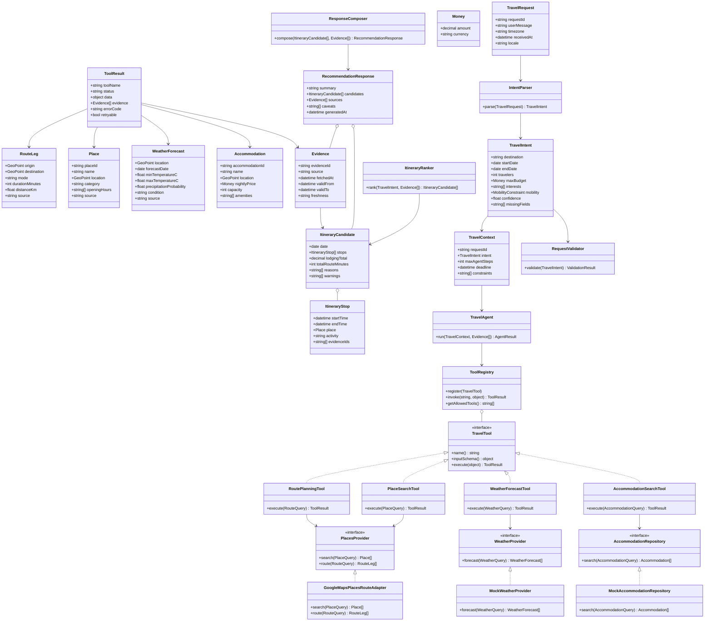

# 도메인 모델 및 Class Diagram

## 1. 클래스 다이어그램



## 2. 책임과 경계

| 클래스/인터페이스 | 책임과 설계 제약 |
|---|---|
| `IntentParser` | LLM 또는 규칙 기반 추출. 응답은 구조화 schema로 검증하며 모호한 필드는 낮은 confidence로 표시 |
| `RequestValidator` | 지역·날짜·예산·인원·시간대 검증. 도구 호출 정책의 최종 권한은 애플리케이션에 둠 |
| `TravelAgent` | LangChain ReAct 실행기. 모델은 tool 선택을 제안하지만, 실제 실행은 `ToolRegistry` 검증을 통과해야 함 |
| `ToolRegistry` | 서버 코드에 선언한 allowlist와 schema만 노출. 모델이 임의 함수/URL을 지정할 수 없음 |
| `TravelTool` | 도구 입력/출력 계약의 공통 인터페이스. 모든 반환은 성공/실패와 출처를 포함 |
| `AccommodationRepository` | 저장소 인터페이스. MVP는 `MockAccommodationRepository`, 이후 실데이터 구현으로 교체 |
| `WeatherProvider` | MVP는 `MockWeatherProvider`가 simulated fixture를 반환하고, 이후 실시간 provider로 교체 |
| `PlacesProvider` | Google Maps adapter가 Places/Routes 결과를 공급자 중립 DTO로 변환하고 인증/timeout/rate limit을 캡슐화 |
| `ItineraryRanker` | hard constraints 통과 후 숙박 총액 오름차순, 동률은 Google Maps 이동 시간으로 정렬 |
| `ResponseComposer` | evidence에 연결된 주장만 요약. 추천 이유와 한계를 분리해 표현 |

## 3. 도메인 규칙

- `startDate < endDate`; `travelers >= 1`; 통화는 ISO 4217 코드와 함께 저장한다.
- 현지 날짜 계산은 목적지/사용자 시간대를 명시하며 UTC와 현지 날짜를 혼용하지 않는다.
- 숙소 가격은 1박 금액인지 전체 금액인지 구분한다. 세금·수수료 포함 여부를 모르면 표시한다.
- 날씨 예보는 provider가 제공하는 최대 기간을 넘겨 실시간 예보처럼 사용하지 않는다.
- 숙소·날씨·장소·경로 DTO에는 `Evidence` 식별자를 연결한다.
- 후보가 hard constraint(수용 인원, 예산 상한, 날짜)를 위반하면 점수가 높아도 추천 대상에서 제외한다.
- 숙소/날씨 fixture는 `source`를 구분하고 `freshness=simulated`로 표시한다.
- 추천은 최저 숙박 총액 우선이며, 동률일 때만 Google Maps 이동 시간을 사용한다.

## 4. 계층형 설계 제안

```text
presentation/
  TravelController
application/
  RecommendItineraryUseCase
  IntentParser
  RequestValidator
  TravelAgent
  ItineraryRanker
  ResponseComposer
domain/
  TravelIntent, TravelContext, Evidence, ItineraryCandidate, RecommendationResponse
  TravelTool interfaces and policies
infrastructure/
  LangChainAgentAdapter
  MockAccommodationRepository (MVP)
  MockWeatherProvider (MVP)
  GoogleMapsPlacesRouteAdapter
  AccommodationRepositorySql (post-MVP)
  WeatherApiAdapter (post-MVP)
  SecretProvider, Cache, Telemetry
```

도메인 계층은 LangChain·DB·특정 API SDK를 import하지 않는다. 외부 기술 교체와 테스트를 위해 application이 인터페이스에 의존하고 infrastructure가 구현한다.
