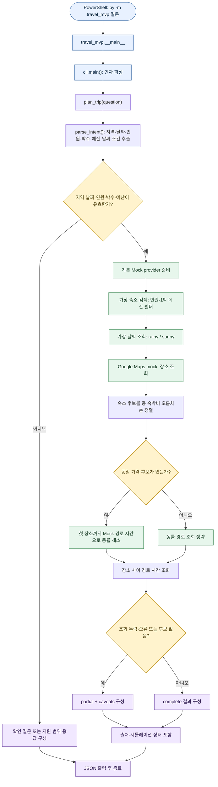

# 여행 MVP CLI 실행 순서

## 텍스트 순서

실행 예:

```powershell
py -m travel_mvp "내일 광화문 2명 1박, 숙소 15만원 이하, 비 예보를 고려해줘"
```

1. Python이 [`__main__.py`](../travel_mvp/__main__.py)를 실행하고 [`cli.main()`](../travel_mvp/cli.py#L8)을 호출한다.
2. CLI가 질문을 인자로 읽고 [`plan_trip()`](../travel_mvp/planner.py#L121)을 호출한다.
3. `plan_trip()`이 [`parse_intent()`](../travel_mvp/intent.py#L68)를 호출해 지역, 날짜, 인원, 숙박 일수, 예산, 비/실내 선호를 추출한다.
4. 지역/날짜 등 조건이 지원되지 않거나 유효하지 않으면 확인/지원 범위 결과를 만들고, provider를 호출하지 않은 채 JSON을 출력한다.
5. 조건이 유효하면 가상 숙소, 가상 날씨, Google Maps mock provider를 준비한다.
6. 가상 숙소 검색은 인원 수용 가능 여부와 1박 예산 상한으로 후보를 거른다.
7. 날씨 fixture는 질문에 비 요청이 있으면 `rainy`, 아니면 `sunny` 시나리오를 반환한다.
8. 지도 mock은 날씨/실내 선호에 맞는 장소를 반환하고, 장소 사이 경로 시간을 제공한다. 숙소 가격이 같은 경우에만 첫 장소까지의 경로 시간으로 순위를 비교한다.
9. provider 결과를 출처와 `simulated` 상태로 묶는다. 조회 실패/경로 누락은 지어내지 않고 주의사항으로 기록한다.
10. 최종 결과를 `complete` 또는 `partial` 상태의 JSON으로 터미널에 출력한다.

이번 실행은 fixture/mock만 사용하며 실제 Google Maps API나 LLM을 호출하지 않는다.

## 시각화 도구로 그린 흐름

Pylance `flowGraph`로 `cli.main()`의 `plan_trip()` 호출 지점을 확인했다. 아래 Mermaid 흐름도는 그 호출을 따라 실제 helper/provider 실행 순서와 분기까지 펼쳐 보인다.


