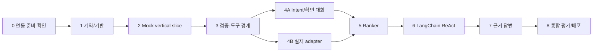

# 단계별 개발 순서

## 권장 시작점

**MVP 범위는 확정됐으므로 첫 개발 항목은 데이터 계약과 프로젝트 기반이다.** 도구 입력·출력, 날짜/통화 규칙, 실패 상태를 먼저 정한다. LangChain Agent나 프롬프트를 먼저 만들면 서비스 규칙이 프롬프트와 공급자 응답에 흩어진다.

첫 번째 구현 목표는 실제 API 없이도 동작하는 **한 지역 여행 추천 vertical slice**다.

```text
질문 → 구조화된 TravelIntent → 검증 → mock 숙소/날씨/장소 도구
→ 제약 필터링/일정 정렬 → 근거 포함 답변
```

초기 세로 기능은 서울 광화문 가상 숙소/날씨, Google Maps의 mock, 예산순 정렬로 검증한다. 이후 Google Maps adapter를 실제 API에 연결하고, 숙소/날씨는 가상 fixture를 유지한다. 마지막에 ReAct Agent가 도구를 선택하게 한다.

## 1. 개발 단계와 완료 기준

| 순서 | 단계 | 주요 작업 | 산출물 / 완료 기준 |
|---:|---|---|---|
| 0 | **연동 준비 확인** | 확정된 MVP 정의를 기준으로 Google Maps 프로젝트/API, billing, key restriction, quota/비용 상한을 확인한다. 가상 숙소/날씨 fixture schema와 시나리오를 확정한다. | Maps API 사용 가능 여부가 확인됨. secret 없이 mock 개발을 시작할 수 있고, fixture가 모두 `simulated`로 표시됨. |
| 1 | **프로젝트 기반과 계약** | Python/LangChain/모델 adapter 버전을 고정한다. 설정·secret 경계를 만들고 `TravelIntent`, `Money`, `Evidence`, `ToolResult`, 응답 상태를 코드 schema로 정의한다. | schema validation과 오류 envelope의 단위 테스트 통과. API 키가 코드·테스트 fixture·로그에 없음. |
| 2 | **Mock 기반 세로 기능** | 광화문 가상 숙소·날씨 fixture 및 Google Maps mock adapter를 만든다. 실제 요청부터 근거 포함 일정 출력까지 LLM 없이 연결한다. | UC-01 정상 예제가 실행되고 가상 가격/날씨는 `simulated`로, 지도 결과는 mock evidence로 식별됨. |
| 3 | **도메인 검증·도구 경계** | 필수 슬롯, 날짜/시간대, 인원, 통화, 예산 검증을 구현한다. Tool Registry allowlist, input schema, timeout/deadline, 재시도/호출 제한을 구현한다. | 누락·모호 입력은 외부 호출 전에 확인 질문. unknown tool, 잘못된 인자, 제한 초과는 도구 실행 없이 명시적 오류. |
| 4A | **질문 이해와 확인 대화** | LLM 또는 규칙 기반 parser가 구조화 `TravelIntent`를 만든다. confidence와 missing fields를 반환하고, 모호한 지역/날짜를 확인한다. | 고정 한국어 eval 질문에서 slot 추출 테스트 통과. JSON/schema 오류나 낮은 confidence가 임의 기본값으로 바뀌지 않음. |
| 4B | **Google Maps adapter** | Places/Routes API를 adapter로 연결한다. 인증, attribution, timeout, quota, source/fetched_at을 정규화한다. 숙소/날씨는 가상 fixture를 유지한다. | Google Maps contract/mock 테스트 통과. Maps 장애 시 결과를 만들어내지 않고 경로 정보 누락을 명시함. |
| 5 | **제약 필터와 일정 Ranker** | 지역·인원·날짜·예산 등 hard constraint를 코드로 적용한 뒤 숙박 총액 오름차순으로 정렬한다. 가격 동률은 Google Maps 이동 시간으로 해소한다. | hard constraint 위반률 0%. 후보 순위와 제외 이유가 동일 입력에서 결정론적으로 재현됨. |
| 6 | **LangChain ReAct 연결** | 승인된 LangChain 버전에 맞는 Agent adapter를 만든다. mock tools를 먼저 연결한 뒤 실제 도구로 교체한다. Observation 전달, step/cost budget, tool-call 검증을 적용한다. | ReAct가 필요한 도구를 호출하고 결과를 다음 turn에 사용함. 허용되지 않은 tool은 실행되지 않으며 무한 loop/초과 비용이 없음. |
| 7 | **근거 기반 답변 생성** | Composer가 숙소·날씨·장소·경로 근거를 사용자 일정으로 요약한다. 출처와 조회 시각, 예보 범위, 대안 및 누락 정보를 표시한다. 생성 답변의 사실을 evidence와 대조한다. | 근거 없는 가격·날씨·이동 시간이 답변에 없고, 실패한 소스는 caveat에 나타남. |
| 8 | **통합 평가와 제한 배포** | E2E, provider 장애, prompt injection, 개인정보 로그, 부하/비용, 한국어 eval을 실행한다. shadow/canary로 실제 품질을 관찰한다. | 인수 기준과 보안 기준 통과. p95·오류율·요청당 비용이 승인 범위 안. 롤백 절차 확인. |

### 선행 관계



4A와 4B는 1~3단계의 공통 schema와 mock 흐름이 안정된 후 병렬 진행할 수 있다. 나머지는 완료 기준을 통과한 뒤 다음 단계로 이동한다.

## 2. 첫 2주 작업안(소규모 팀 기준)

기간은 추정치다. API 계약 협의와 계정 승인 일정에 따라 조정한다.

### 1주차: 계약과 mock end-to-end

1. **제품/데이터 담당:** 확정된 광화문 범위, fixture 시나리오, 150,000원 제안 상한(설정 가능), 개인정보/비용 상한 확인.
2. **Backend:** repository 골격, 설정/secret 로딩, request ID, typed DTO와 error envelope 구현.
3. **Backend + QA:** 숙소·날씨·장소 mock fixtures와 `TravelIntent` validation 테스트 작성.
4. **Backend:** mock만으로 질문→도구 결과→정렬→답변을 연결하고, 정상·누락값·부분 실패 예제 시연.

**1주차 종료 게이트:** 외부 API/LLM 없이 수용 조건을 검증할 수 있고, mock 데이터의 출처/시각이 답변까지 보존된다.

### 2주차: Google Maps 연동과 질문 해석

1. **Integration 담당:** Google Maps Places/Routes adapter 구현. key restriction, attribution, timeout/quota, 약관상 cache 조건 검증.
2. **Integration 담당:** Maps adapter를 HTTP mock으로 검증하고 API key가 없거나 호출이 실패할 때 명시적 부분 결과를 확인.
3. **NLP/Backend 담당:** structured intent extraction 및 missing-field 확인 흐름 구현. 실제 모델 없이 parser fixture 평가부터 시작.
4. **팀 공동:** mock adapter와 실제 adapter를 같은 interface로 교체해 UC-01을 검증.

**2주차 종료 게이트:** 가상 숙소/날씨는 `simulated`로 유지되고 Google Maps 결과/장애가 재현 가능하다. ReAct는 아직 붙이지 않아도 된다.

## 3. LangChain Agent를 붙이는 순서

1. 먼저 `TravelIntent`와 도구 schema를 확정하고 mock tool로 registry contract를 검증한다.
2. 모델 없이 tool을 직접 실행하는 application use case와 Ranker를 테스트한다.
3. 승인된 LangChain 버전의 Agent API를 선택하고, adapter 한 곳에서만 버전별 차이를 격리한다.
4. 첫 Agent 실행에는 mock read-only tools만 등록한다. 도구 선택/인자/Observation/종료 상태를 trace로 확인한다.
5. schema validation·allowlist·step limit·timeout·token/cost limit을 통과하면 실제 provider adapter를 연결한다.
6. Agent의 최종 문장을 그대로 신뢰하지 않는다. 근거 집합에 연결된 값만 답변 schema에 허용한다.

**금지 순서:** 프롬프트 튜닝 → 임의 tool 실행 허용 → 외부 API 직접 연결 → 나중에 검증 추가. 검증과 비용/권한 경계는 첫 tool 통합 전에 구현한다.

## 4. 역할 분담 제안

| 역할 | 담당 범위 |
|---|---|
| Product/Domain | MVP 사용자 흐름·hard constraint·예산순 ranking·인수 기준 |
| Backend/Domain | DTO, validator, use case, tool registry, Ranker, API endpoint |
| Data Integration | 가상 fixture 관리, Google Maps Places/Routes adapter 및 source/freshness 정규화 |
| LLM/Agent | intent extraction, clarification, LangChain ReAct adapter, 답변 구성 |
| QA/SRE/Security | fixture/eval set, provider 계약·장애 시험, 비용·로그·배포 감시 |

작은 팀에서는 역할을 겸할 수 있지만, schema와 테스트 기준은 한 곳에서 리뷰한다.

## 5. 각 단계 공통 Definition of Done

- 변경된 요구사항과 데이터 계약이 문서화되어 있다.
- 정상 흐름과 최소 한 가지 실패 흐름의 자동 테스트가 있다.
- 비밀정보·개인정보가 코드, fixture, 일반 로그에 들어가지 않는다.
- 시간대·통화·출처·조회 시각이 응답까지 보존된다.
- 도구 권한, timeout, 재시도, 비용/호출 한도가 동작한다.
- 수동 테스트 방법과 결과를 기록하고, 이전 단계의 acceptance criteria가 유지된다.

## 6. 착수 전 체크리스트

- [ ] Google Maps Platform project/API, billing, key restriction, quota, 비용 상한 확인
- [ ] 광화문 가상 숙소/날씨 fixture schema와 scenario 목록 작성
- [ ] 150,000 KRW/실/박 기본 예산 상한을 설정값으로 구현
- [ ] 숙박 총액 오름차순, 동률 시 Google Maps 경로 시간 기준을 테스트로 고정
- [ ] 숙소/날씨의 simulated 표시 및 예약·결제 기능 제외 확인
- [ ] LangChain과 모델 provider 버전 선택 및 lock 파일 갱신 절차 합의
- [ ] 사용자 입력/trace/log 보존·삭제 정책 승인
- [ ] 테스트용 비밀 없는 mock fixtures와 한국어 eval 질문 준비
