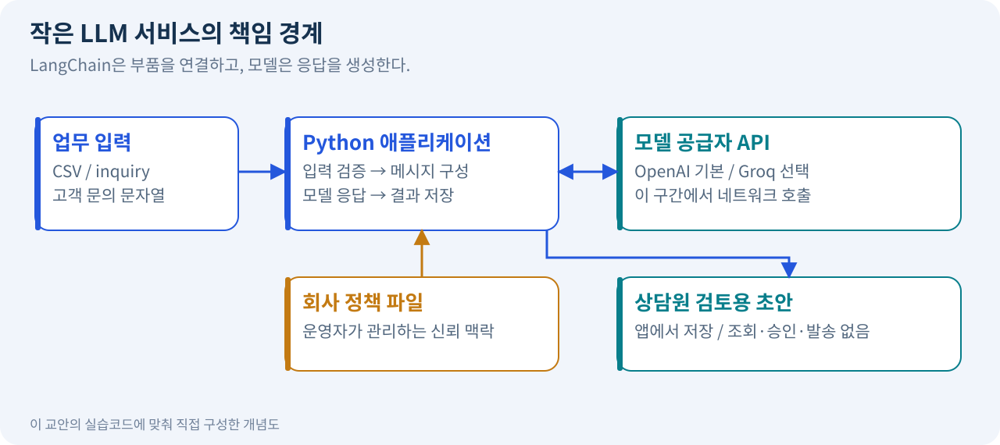

# 1차시. 환경 구축과 LLM 애플리케이션의 전체 구조

> 답변 생성 프로그램은 어떤 부품으로 이루어질까?



| 구성 | 시간 |
|---|---:|
| 업무 문제·전체 구조 | 5분 |
| 모델·프레임워크·패키지 이론 | 15분 |
| 가상환경·패키지 설치 | 20분 |
| 로컬 템플릿 실행·결과 해설 | 10분 |

## 업무에서 출발하기

쇼핑몰 상담원은 같은 반품 정책을 여러 고객에게 반복해서 설명한다. 매번 직접 작성하면 시간이 걸리고, 회사 정책과 다른 안내가 섞일 수 있다. 오늘 만들 프로그램은 **고객 문의와 회사 정책을 받아 상담원이 검토할 답변 초안을 만드는 도우미**다. 반품을 승인하거나 실제 메시지를 발송하지 않는다. 프로그램의 입력은 문의 텍스트, 근거는 운영자가 관리하는 정책 파일, 출력은 검토용 답변 문자열이다.

이 프로그램에서 자연어를 생성하는 주체는 LLM이다. LangChain은 문의를 적절한 메시지로 만들고, 모델을 호출하고, 받은 결과를 다음 처리로 넘기는 연결 구조를 제공한다. 프레임워크를 설치했다고 모델이 PC 안에 다운로드되지는 않는다. OpenAI를 선택하면 네트워크를 통해 해당 서비스의 모델을 호출한다. 모의 모드는 호출 없이 고정된 응답을 돌려준다.

## 모델·API·프레임워크를 나누어 생각하기

식당에 비유하면 모델은 조리 능력, API는 주문을 주고받는 창구, LangChain은 주문서를 정리하고 결과를 전달하는 작업 흐름이다. 실제로는 API 키가 호출 권한을 제공하고 모델 ID가 호출 대상을 정한다. 둘 중 하나만 맞아서는 실행되지 않는다. 비유의 ‘조리 능력’과 달리 모델은 회사의 현재 주문 상태를 스스로 조회하지 못한다. 조회 시스템과 연결하지 않은 정보는 프로그램이 알 수 없다.

| 부품 | 책임 | 이번 프로젝트의 구현 |
|---|---|---|
| Python 실행환경 | 패키지와 프로그램 실행 | 프로젝트 전용 `.venv` |
| LangChain Core | 메시지·템플릿·Runnable·출력 파서 | `langchain-core` |
| 공급자 통합 | 모델 API 요청·응답 변환 | `langchain-openai` |
| 생성 모델 | 입력 메시지를 바탕으로 응답 생성 | `.env`의 `OPENAI_MODEL` |
| 업무 데이터 | 답변에 사용할 회사 정책 | `data/policy.txt` |
| 애플리케이션 | 입력 검증·흐름 연결·파일 저장 | `app/`, `sessions/` |

LangChain은 모듈로 나뉜 생태계다. 이번 범위는 템플릿·LCEL이므로 Core와 OpenAI 통합을 설치한다. 상위 에이전트 기능을 담은 `langchain` 패키지와 LangGraph를 먼저 설치할 필요는 없다. 필요한 의존성만 설치하면 오류 원인과 코드의 책임을 따라가기 쉽다.

## 가상환경이 필요한 이유

패키지는 프로젝트마다 요구 버전이 다를 수 있다. 시스템 Python에 모든 패키지를 설치하면 다른 프로젝트를 수정하다가 오늘 코드가 영향을 받을 수 있다. `.venv`는 이 프로젝트가 사용할 Python과 패키지 공간을 분리한다. VS Code에서 선택한 인터프리터와 터미널의 Python이 같은 환경인지도 확인해야 한다.

프로젝트 루트는 `requirements.txt`, `app`, `sessions`가 있는 폴더다. 모든 명령은 이 폴더에서 실행한다. `python -m pip`는 지금 선택한 Python에 패키지를 설치하며, `python -m sessions.s01`은 루트를 모듈 검색 시작점으로 사용한다. `sessions` 폴더 안으로 들어가 `python s01.py`로 실행하면 이후 차시의 `app` import가 실패할 수 있다.

## 환경 구성

Python 3.11 이상을 수업 기준으로 가정한다. 제작 검증은 Python 3.12에서 수행했다. Windows CMD에서는 다음 명령을 차례로 실행한다.

```bat
python -m venv .venv
.venv\Scripts\activate.bat
python -m pip install -r requirements.txt
python -m pip check
python -m sessions.s01
```

PowerShell은 활성화 명령만 `.\.venv\Scripts\Activate.ps1`로 바꾼다. 실행 정책 때문에 활성화가 차단되면 정책을 변경하지 않고 `.\.venv\Scripts\python.exe -m pip install -r requirements.txt`와 `.\.venv\Scripts\python.exe -m sessions.s01`처럼 가상환경의 Python을 직접 실행할 수 있다. Linux/macOS는 `python3 -m venv .venv`, `source .venv/bin/activate`를 사용한다.

## 첫 번째 코드가 하는 일

`ChatPromptTemplate.from_template()`은 문자열의 `{inquiry}` 자리에 값을 넣을 수 있는 메시지 템플릿을 만든다. `prompt.invoke()`의 결과는 모델 답변이 아니라 **채워진 프롬프트 객체**다. `to_messages()`로 그 안에 어떤 메시지가 들어 있는지 확인한다. API 호출은 아직 한 번도 발생하지 않는다.

## 실행과 출력 해석

실행 파일은 `sessions/s01.py`다. 설치 버전 다음에 다음과 같은 내용을 확인한다.

```text
API 호출 없음 / ChatPromptValue
고객 문의: 미사용 상품을 반품하고 싶어요.
```

`ModuleNotFoundError`가 발생하면 VS Code 인터프리터와 `python -m pip show langchain-core`를 확인한다. API 키가 없어도 1~3차시는 정상 실행되어야 한다. 수업 종료 시 가상환경을 나가려면 `deactivate`를 실행한다.

다음 차시에는 한 문장을 시스템 메시지와 사용자 메시지로 나누고, 템플릿의 변수와 실제 입력을 연결한다.


## 차시 실행 코드

`sessions/s01.py`

```python
import platform
from importlib.metadata import version
from langchain_core.prompts import ChatPromptTemplate


def main():
    print("Python:", platform.python_version())
    for package in ("langchain-core", "langchain-openai", "python-dotenv"):
        print(package, version(package))
    prompt = ChatPromptTemplate.from_template("고객 문의: {inquiry}")
    value = prompt.invoke({"inquiry": "미사용 상품을 반품하고 싶어요."})
    print("API 호출 없음 /", type(value).__name__)
    print(value.to_messages()[0].content)

if __name__ == "__main__":
    main()

```
