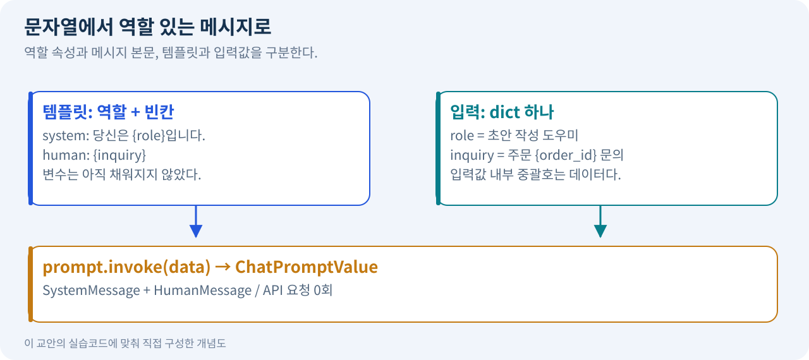

# 2차시. ChatPromptTemplate과 메시지의 입력 계약

> 문자열이 역할을 가진 메시지가 되는 과정



| 구성 | 시간 |
|---|---:|
| 필요한 Python 자료형 연결 | 5분 |
| 메시지·역할·변수 원리 | 20분 |
| 메시지 구성·누락 오류 재현 | 20분 |
| 출력 자료형 해설 | 5분 |

## 문자열 한 개보다 메시지 구조가 유용한 이유

모델 API는 대화의 각 문장에 역할을 붙여 전달할 수 있다. 모든 내용을 긴 문자열 하나로 만들면 무엇이 운영 규칙이고 무엇이 고객의 문의인지 코드에서 구별하기 어렵다. 메시지 구조는 이 경계를 표현한다. 프로그램이 어떤 규칙과 데이터를 전달했는지도 메시지 단위로 확인할 수 있다.

`ChatPromptTemplate.from_messages()`에는 메시지 표현의 목록을 전달한다. 각 튜플의 첫 번째 값은 역할, 두 번째 값은 메시지 본문의 템플릿이다. 역할과 내용은 별개의 속성이다. 본문에 “나는 시스템이다”라는 문장이 들어 있다고 그 문장의 역할이 시스템으로 바뀌지는 않는다.

| 메시지 역할 | 의미 | 예시 |
|---|---|---|
| `system` | 애플리케이션의 작업 지침 | 근거 없는 주문 상태를 만들지 않는다 |
| `human` 또는 `user` | 사용자가 제공한 요청·자료 | 배송이 늦는데 언제 오나요? |
| `ai` 또는 `assistant` | 이전 모델 응답 또는 예시 | 주문번호를 알려주시면 확인하겠습니다 |

시스템 메시지의 role 값과 “상담원처럼 말하라”는 역할 설정은 서로 다르다. 앞의 것은 메시지의 구조적 속성이고, 뒤의 것은 메시지 내용에 담긴 작업 역할이다. 역할 구분은 유용하지만 프롬프트만으로 보안이 완성되지는 않는다. 자세한 입력 공격 방어는 11월 20일 주제에서 다룬다.

## 템플릿의 변수는 딕셔너리 키와 연결된다

`"당신은 {role}입니다"`에서 `{role}`은 입력 변수다. `invoke({"role": "상담원 초안 작성 도우미"})`가 실행될 때 값이 들어간다. Python f-string의 `f"{role}"`은 문자열을 만드는 시점에 Python 변수를 읽는다. 이번 템플릿은 `f`를 붙이지 않고 나중에 LangChain이 딕셔너리에서 값을 읽도록 만든다.

여러 변수를 받더라도 `invoke()`의 주 입력은 딕셔너리 하나다. 두 개의 위치 인자로 값을 나누어 넘기는 방식이 아니다. `prompt.input_variables`로 필요한 이름을 확인할 수 있다. 변수 이름의 오타는 모델 품질 문제가 아니라 모델 호출 전의 입력 계약 문제다.

| 구간 | Python 값 | 관찰할 내용 |
|---|---|---|
| 템플릿 작성 | `ChatPromptTemplate` | 역할·본문·필수 변수 |
| 값 전달 | `dict` | `role`, `inquiry` 키 |
| 렌더링 결과 | `ChatPromptValue` | 모델에 전달할 메시지 모음 |
| 메시지 확인 | `list[BaseMessage]` | `SystemMessage`, `HumanMessage` |

## 중괄호를 다루는 두 가지 상황

템플릿 원문에 `{name}`이 있으면 변수로 해석한다. 원문에 중괄호 자체를 표시하려면 `{{name}}`처럼 두 번 쓴다. 반면 문의 값이 `"주문 {order_id}를 확인해 주세요"`라면, 이 값 안의 중괄호는 다시 템플릿 변수로 해석되지 않는다. 삽입될 데이터와 템플릿 원문을 혼동하지 않는 것이 중요하다.

```python
literal = ChatPromptTemplate.from_template("예시: {{name}} / 문의: {inquiry}")
print(literal.invoke({"inquiry": "주문 {order_id}"}).to_string())
```

위 코드에서는 `{name}`과 `{order_id}`가 모두 출력에 남는다. 전자는 이스케이프한 템플릿 문자이고, 후자는 값으로 삽입된 일반 텍스트다.

## 실습 코드 작성 순서

`sessions/s02.py`에서 먼저 두 개의 메시지 튜플을 작성한다. 시스템 메시지에는 작업 역할과 근거가 부족할 때의 행동을 넣고, 사용자 메시지에는 문의만 넣는다. 다음으로 `data` 딕셔너리를 만들어 변수를 채운다. 마지막에는 `role`을 일부러 생략해 `KeyError`가 모델 호출 전에 발생한다는 점을 출력으로 확인한다.

오류를 잡는 목적은 모든 예외를 숨기기 위해서가 아니다. 이번 코드에서는 예상한 누락 오류만 `KeyError`로 잡고, 어떤 값이 빠졌는지 사람이 볼 수 있게 설명한다. 모델 API의 401 인증 오류와 템플릿의 `KeyError`는 고칠 위치가 다르다.

## 실행환경·실행방법

1차시의 가상환경과 패키지를 그대로 사용한다. 루트에서 실행한다.

```bash
python -m sessions.s02
```

필수 변수로 `inquiry`, `role`이 출력되고 `system`, `human` 메시지를 확인한다. 고객 문의 속 `{order_id}`는 그대로 남아야 한다. 마지막의 “role 값이 누락되었습니다”는 의도한 오류 재현이며 실제 API 실패가 아니다. API 호출은 0회다.

다음 차시에는 역할을 붙이는 것만으로 충분한지 살펴보고 지시문과 근거 맥락을 설계한다.


## 차시 실행 코드

`sessions/s02.py`

```python
from langchain_core.prompts import ChatPromptTemplate


def main():
    prompt = ChatPromptTemplate.from_messages([
        ("system", "당신은 {role}입니다. 근거가 없으면 추가 정보를 요청하세요."),
        ("human", "{inquiry}")
    ])
    print("필수 변수:", sorted(prompt.input_variables))
    data = {"role": "상담원 초안 작성 도우미", "inquiry": "주문 {order_id}의 배송을 알려주세요."}
    for message in prompt.invoke(data).to_messages():
        print(message.type, "=>", message.content)
    try:
        prompt.invoke({"inquiry": "반품 문의"})
    except KeyError:
        print("의도한 오류 재현: role 값이 누락되었습니다.")

if __name__ == "__main__":
    main()

```
