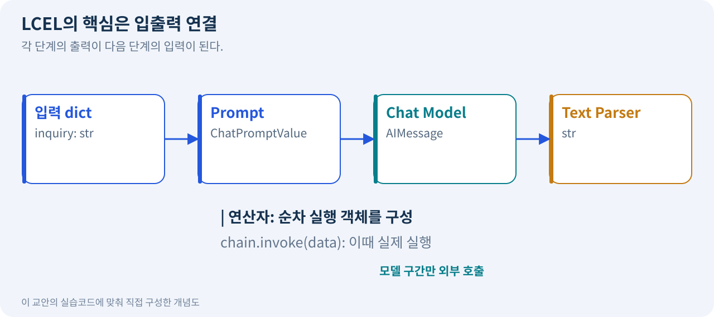

# 4차시. LCEL로 프롬프트·모델·파서 연결하기

> 세 번의 함수 호출이 하나의 체인으로 표현되는 이유



| 구성 | 시간 |
|---|---:|
| 메시지 자료형 재연결 | 5분 |
| Runnable·합성·파서 이론 | 20분 |
| 수동 실행과 LCEL 실행 | 20분 |
| 동작·오류 해설 | 5분 |

## LCEL은 실행 순서를 표현한다

프롬프트를 만든 뒤 모델에 보내고 응답에서 텍스트를 얻는 작업은 일반 Python 변수로도 작성할 수 있다. LCEL은 이 연결 관계를 Runnable이라는 공통 인터페이스로 표현한다. `invoke()`는 하나의 입력을 처리한다. 연결된 부품의 앞 출력이 뒤 부품의 입력이 된다.

```python
value = prompt.invoke(inputs)
message = model.invoke(value)
text = output_parser.invoke(message)
```

위 순서를 선언적으로 쓰면 `chain = prompt | model | output_parser`다. 여기서 `|`는 비트 OR 계산이나 터미널의 파이프 명령을 그대로 실행하는 것이 아니다. Runnable이 연산자를 재정의해 순차 실행 객체를 만든다. `chain`을 구성하는 줄에서는 API 요청이 발생하지 않고 `chain.invoke(inputs)`를 실행할 때 모델 호출이 일어난다.

## 자료형이 연결되어야 흐름이 이어진다

| 컴포넌트 | 입력 | 출력 | 하는 일 |
|---|---|---|---|
| `ChatPromptTemplate` | 템플릿 변수 딕셔너리 | `ChatPromptValue` | 역할 있는 메시지 구성 |
| 채팅 모델 | 프롬프트/메시지 | `AIMessage` | 모델 응답 수신 |
| `StrOutputParser` | 모델 메시지 | `str` | 텍스트를 꺼내 다음 처리에 전달 |

`AIMessage`에는 응답 본문 외에도 모델별 메타데이터와 사용량이 포함될 수 있다. 화면에 문장만 보여줄 때는 파서가 편리하다. 사용량을 기록하려면 파서 이전 단계에서 메시지를 받아야 한다. 7차시 비교 프로그램이 이 이유로 `prompt | model` 결과를 먼저 기록한다.

최신 라이브러리에서는 파서의 반환 클래스 이름이 `TextAccessor`로 보일 수 있다. 이는 문자열 하위형이며 표의 `str`은 문자열 계열 계약을 뜻한다. 클래스 이름과 값의 사용 계약을 구분한다.

파서는 문법이나 정책을 검증하는 만능 검사기가 아니다. `StrOutputParser`에 “환불이 완료되었습니다”라는 메시지를 넣으면 그대로 텍스트를 돌려준다. 실제 환불 여부나 사실 정확성을 보장하지 않는다. 이번 프로젝트가 결과에 ‘초안’이라고 표시하는 이유다.

## 공통 맥락을 고정하는 partial

정책은 고객마다 바뀌지 않으므로 `prompt.partial(context=load_policy())`로 미리 채울 수 있다. 그러면 호출 시에는 `inquiry`만 넘긴다. `partial`은 모델 학습이나 응답 캐시가 아니다. 템플릿의 일부 변수 값을 고정한 새로운 프롬프트를 만드는 작업이다. 정책 파일을 바꾸더라도 이미 만들어진 프롬프트에는 이전 값이 남으므로 다시 생성해야 한다.

## 실제 모델과 모의 모델

`app/providers.py`는 설정에 따라 모델 객체를 만든다. OpenAI는 `ChatOpenAI`, 선택 실습의 Groq는 `ChatGroq`를 사용한다. 모의 모드는 실제 LangChain의 `FakeListChatModel`에 고정 응답을 넣는다. 따라서 **템플릿과 LCEL은 실제 라이브러리로 실행되지만 모델 추론은 일어나지 않는다.** 모의 응답은 모든 문의에 같은 문장을 반환하므로 품질 비교 근거로 사용할 수 없다.

## 실행환경·설정

루트의 `.env.example`을 `.env`로 복사하고 제공받은 키와 사용 가능한 모델 ID를 입력한다. 값을 비워두면 실제 모드는 호출 전에 오류를 표시한다. 이 수업은 모델 ID를 임의로 고정하지 않는다.

```text
LLM_PROVIDER=openai
OPENAI_API_KEY=제공받은_키를_로컬에서만_입력
OPENAI_MODEL=계정에서_허용된_모델_ID
```

위 값은 설명용이며 실제 비밀키가 포함되어 있지 않다. `.env`는 Git에 올리지 않는다. `LLM_TEMPERATURE`는 우선 비워둔다. 지원하는 모델에서만 0 등을 설정한다. 일부 모델은 temperature를 지원하지 않거나 출력 토큰 한도의 의미가 다를 수 있다.

## 실습 실행

```bash
python -m sessions.s04 --mock --manual
python -m sessions.s04 --mock
```

수동 실행에서는 `ChatPromptValue AIMessage TextAccessor`가 출력될 수 있다. 검증 버전의 `TextAccessor`는 `str`의 하위 자료형이므로 문자열처럼 사용할 수 있다. `str(result)`로 일반 문자열을 얻을 수도 있다. LCEL 실행에서는 최종 문자열만 출력된다. 모의 입력·응답이 같으므로 결과가 같아야 한다. 실제 호출은 아래 명령 하나부터 실행한다.

```bash
python -m sessions.s04
```

정상 실행당 모델 요청은 1회다. 수동 모드와 LCEL 모드를 둘 다 실제 실행하면 총 2회이며 실제 응답은 달라질 수 있다. 연결 순서가 같은 것과 비결정적 문장이 매번 같은 것은 구분한다.

401은 키, 403은 권한, 404는 모델/주소, 400은 파라미터 지원을 확인한다. 429에서는 한도·크레딧을 확인하고 기다린다. 프로그램은 자동 재시도나 다른 유료 공급자로의 전환을 하지 않는다.


## 차시 실행 코드

`sessions/s04.py`

```python
import argparse
from langchain_core.output_parsers import StrOutputParser
from app.config import Settings
from app.providers import make_model, friendly_error
from app.prompts import get_prompt
from app.pipeline import load_policy, load_cases


def main():
    parser = argparse.ArgumentParser()
    parser.add_argument("--mock", action="store_true")
    parser.add_argument("--manual", action="store_true")
    args = parser.parse_args()
    settings = Settings.read(args.mock)
    model = make_model(settings)
    prompt = get_prompt().partial(context=load_policy())
    inputs = {"inquiry": load_cases()[0]["inquiry"]}
    output_parser = StrOutputParser()
    print(settings.provider, settings.model)
    if args.manual:
        value = prompt.invoke(inputs)
        message = model.invoke(value)
        result = output_parser.invoke(message)
        print("타입:", type(value).__name__, type(message).__name__, type(result).__name__)
    else:
        chain = prompt | model | output_parser
        result = chain.invoke(inputs)
    print(result)

if __name__ == "__main__":
    try:
        main()
    except Exception as error:
        raise SystemExit(friendly_error(error))

```

### 구현 파일: app/config.py

```python
from dataclasses import dataclass
from pathlib import Path
import os
from dotenv import load_dotenv

ROOT = Path(__file__).resolve().parents[1]
load_dotenv(ROOT / ".env", override=False)

@dataclass(frozen=True)
class Settings:
    provider: str
    model: str
    max_output: int = 500
    temperature: float | None = None

    @classmethod
    def read(cls, mock=False):
        provider = "mock" if mock else os.getenv("LLM_PROVIDER", "openai").lower()
        if provider not in {"openai", "groq", "mock"}:
            raise ValueError("LLM_PROVIDER는 openai/groq/mock 중 하나여야 합니다.")
        prefix = provider.upper()
        model = "local-fixture" if provider == "mock" else os.getenv(prefix + "_MODEL", "").strip()
        if not model:
            raise ValueError(prefix + "_MODEL에 계정에서 허용된 모델 ID를 설정하세요.")
        if provider != "mock" and not os.getenv(prefix + "_API_KEY", "").strip():
            raise ValueError(prefix + "_API_KEY가 없습니다. .env를 확인하세요.")
        raw = os.getenv("LLM_TEMPERATURE", "").strip()
        temperature = float(raw) if raw else None
        if temperature is not None and not 0 <= temperature <= 2:
            raise ValueError("LLM_TEMPERATURE는 0~2 범위여야 합니다.")
        return cls(provider, model, temperature=temperature)

```

### 구현 파일: app/providers.py

```python
from app.config import Settings

MOCK_TEXT = "[모의 응답] 안녕하세요. 제공된 정책과 문의를 확인해 상담원이 안내할 내용을 작성합니다. 주문 상태와 승인 여부는 별도 확인이 필요합니다. 문의별 실제 답변을 생성한 결과는 아닙니다."

def make_model(settings: Settings):
    if settings.provider == "mock":
        from langchain_core.language_models.fake_chat_models import FakeListChatModel
        return FakeListChatModel(responses=[MOCK_TEXT])
    common = dict(model=settings.model, max_tokens=settings.max_output,
                  timeout=30, max_retries=0)
    # temperature를 지원하지 않는 모델을 위해 미설정 시 전달하지 않는다.
    if settings.temperature is not None:
        common["temperature"] = settings.temperature
    if settings.provider == "openai":
        from langchain_openai import ChatOpenAI
        return ChatOpenAI(**common)
    if settings.provider == "groq":
        from langchain_groq import ChatGroq
        return ChatGroq(**common)
    raise ValueError("지원하지 않는 공급자입니다.")

def friendly_error(error):
    status = getattr(error, "status_code", None)
    if status in {400, 401, 403, 404, 429}:
        return {400: "요청 설정 오류: 모델과 파라미터 지원을 확인하세요.",
                401: "인증 오류: API 키를 확인하세요.",
                403: "권한 오류: 프로젝트와 모델 권한을 확인하세요.",
                404: "모델/주소 오류: 사용 가능한 모델 ID를 확인하세요.",
                429: "호출/토큰/크레딧 한도: 콘솔 확인 후 기다렸다가 수동 재실행하세요."}[status]
    if isinstance(error, (ValueError, KeyError, TypeError, FileNotFoundError)):
        return str(error)
    # 외부 오류 본문·헤더·키를 그대로 로그에 기록하지 않는다.
    return f"{type(error).__name__}: 연결/타임아웃/공급자 상태를 확인하세요."

```
