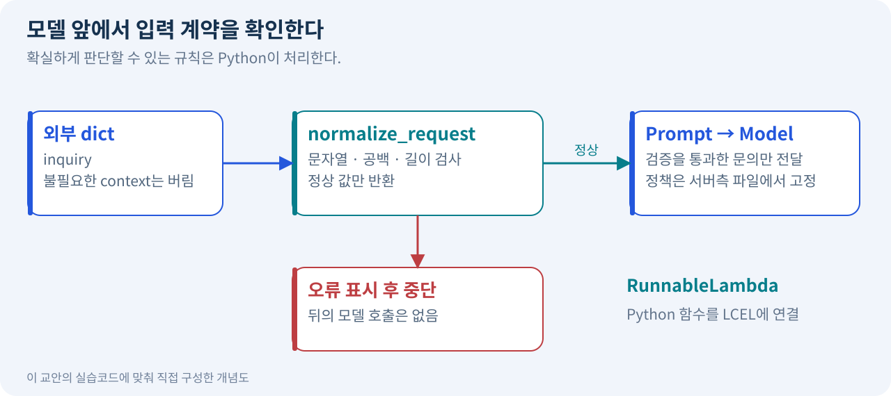

# 5차시. RunnableLambda로 업무 입력을 체인에 연결하기

> 모델 호출 전에 정확히 처리해야 할 일



| 구성 | 시간 |
|---|---:|
| 외부 입력 계약 설명 | 5분 |
| 전처리·책임 경계 이론 | 20분 |
| 정규화 함수를 LCEL에 연결 | 20분 |
| 실패 입력과 복구 해설 | 5분 |

## 프롬프트가 모든 일을 처리하게 하지 않는다

빈 문의가 들어왔을 때 모델에게 “문의가 비었는지 판단해 줘”라고 요청할 필요는 없다. Python이 정확하고 저렴하게 처리할 수 있는 일이다. 문자열 여부, 공백 입력, 길이 제한 같은 조건은 모델 호출 전에 검사한다. 모델은 규칙으로 처리하기 어려운 자연어 생성에 사용한다.

전처리는 데이터를 원하는 계약에 맞게 만드는 과정이다. 이번에는 앞뒤 공백을 제거하고 문의의 길이를 검사한다. 문장 내부의 숫자, 부정 표현, 주문번호, 중괄호를 삭제하지 않는다. 특히 “미사용”을 “사용”으로 바꾸거나 두 문장을 임의로 합치면 업무 의미가 달라질 수 있다.

| 입력 | 처리 결과 | 모델 호출 |
|---|---|---|
| `{"inquiry": "  반품 문의  "}` | 공백 제거 후 문의 전달 | 진행 |
| `{"inquiry": ""}` | 값 오류 | 없음 |
| `{"inquiry": None}` | 값 오류 | 없음 |
| `{"inquiry": "가" * 1001}` | 수업용 길이 제한 오류 | 없음 |
| `"반품 문의"` | dict 형식 오류 | 없음 |

1000자는 수업에서 정한 문자 수 제한이며 1000토큰 제한이 아니다. 한국어 토큰 수는 문자 수와 일치하지 않는다. 큰 문서의 토큰 예산은 별도 측정해야 한다.

## RunnableLambda는 Python 함수를 체인 부품으로 만든다

`normalize_request(row)`는 딕셔너리를 받아 `{"inquiry": 정리한_문자열}`을 반환한다. `RunnableLambda(normalize_request)`로 감싸면 다른 Runnable처럼 `invoke`, `batch`에 연결할 수 있다. 함수에 여러 업무 값이 필요하면 여러 위치 인자를 임의로 늘리는 대신 딕셔너리 하나로 전달하면 연결 계약이 단순해진다. 추가 설정 인자를 받는 고급 형태도 있지만 오늘은 단일 업무 입력에 집중한다.

```python
chain = (
    RunnableLambda(normalize_request)
    | prompt
    | model
    | StrOutputParser()
)
```

`normalize_request`에서 예외가 발생하면 뒤의 prompt·model로 넘어가지 않는다. 이런 구조가 입력 오류에 불필요한 호출 비용이 발생하는 것을 막는다. 단, 실제 서비스의 보안 요구를 문자열 검증만으로 해결하는 것은 아니다.

## 정책과 고객 입력을 분리한다

CSV에 고객이 `context`라는 칼럼을 추가했다고 회사 정책이 바뀌면 안 된다. `normalize_request`는 문의만 반환하고, 정책은 `build_chain()`이 운영자 파일에서 읽어 고정한다. 필요한 데이터만 다음 단계에 넘기는 설계다. 이는 ‘유효한 dict인가’뿐 아니라 ‘누가 어떤 값을 정할 수 있는가’를 구분하는 문제다.

책임도 나눈다. `app/config.py`는 설정, `app/providers.py`는 공급자 연동, `app/prompts.py`는 메시지, `app/pipeline.py`는 입력과 흐름을 담당한다. 처음부터 모든 클래스를 만들 필요는 없지만, 실습이 커질수록 각 변경의 위치를 알 수 있어야 한다.

## 코드의 핵심을 작성하는 순서

먼저 일반 Python 함수로 입력을 검사하고 반환값을 확인한다. 다음으로 `prompt.partial()`에 정책을 고정한다. 마지막에 함수를 Runnable로 감싸 모델과 연결한다. 이렇게 하면 오류가 발생했을 때 ‘입력이 문제인가, 메시지가 문제인가, API가 문제인가’를 앞에서부터 추적할 수 있다.

## 실행환경·실행방법

```bash
python -m sessions.s05 --mock
python -m sessions.s05 --mock --inquiry ""
python -m sessions.s05 --mock --inquiry "주문 {order_id} 배송을 알려주세요."
```

첫 실행은 공백이 제거된 문의를 처리한다. 두 번째는 문의가 비었다는 안내와 함께 종료 코드 1로 끝난다. 셋째는 중괄호를 일반 텍스트로 보존한다. 실제 호출은 `--mock`을 빼고 수행하며 정상 입력당 1회다.

정상 입력을 처리하는 것과 잘못된 입력을 조용히 무시하는 것은 다르다. 문제가 있으면 이유를 표시하고 입력을 고친다. 다음 차시에서는 같은 입력 계약을 가진 요청 여러 개를 처리하고 결과를 조금씩 보여주는 방식을 배운다.


## 차시 실행 코드

`sessions/s05.py`

```python
import argparse
from app.config import Settings
from app.providers import make_model, friendly_error
from app.pipeline import build_chain


def main():
    parser = argparse.ArgumentParser()
    parser.add_argument("--mock", action="store_true")
    parser.add_argument("--inquiry", default="  미사용 상품의 반품 조건을 알려주세요.  ")
    args = parser.parse_args()
    settings = Settings.read(args.mock)
    chain = build_chain(make_model(settings))
    print("입력:", repr(args.inquiry))
    print(chain.invoke({"inquiry": args.inquiry}))

if __name__ == "__main__":
    try:
        main()
    except Exception as error:
        raise SystemExit(friendly_error(error))

```

### 구현 파일: app/pipeline.py

```python
import csv
import json
from pathlib import Path
from langchain_core.runnables import RunnableLambda
from langchain_core.output_parsers import StrOutputParser
from app.config import ROOT
from app.prompts import get_prompt


def load_policy():
    return (ROOT / "data/policy.txt").read_text(encoding="utf-8").strip()


def normalize_request(row):
    if not isinstance(row, dict):
        raise TypeError("입력은 dict여야 합니다.")
    value = row.get("inquiry")
    if not isinstance(value, str) or not value.strip():
        raise ValueError("inquiry는 공백이 아닌 문자열이어야 합니다.")
    value = value.strip()
    if len(value) > 1000:
        raise ValueError("inquiry는 1000자 이내여야 합니다.")
    # 원문의 의미·숫자·중괄호는 바꾸지 않는다.
    return {"inquiry": value}


def build_chain(model, version="designed"):
    # 운영자가 관리하는 정책은 시작 시 고정한다. 고객 CSV에서 context를 받지 않는다.
    prompt = get_prompt(version).partial(context=load_policy())
    return RunnableLambda(normalize_request) | prompt | model | StrOutputParser()


def load_cases():
    return json.loads((ROOT / "data/cases.json").read_text(encoding="utf-8"))


def read_requests(path):
    path = Path(path)
    with path.open(encoding="utf-8-sig", newline="") as f:
        reader = csv.DictReader(f)
        if not reader.fieldnames or not {"id", "inquiry"} <= set(reader.fieldnames):
            raise ValueError("CSV 헤더에는 id,inquiry가 필요합니다.")
        rows = list(reader)
    if len(rows) > 100:
        raise ValueError("수업용 CSV는 최대 100행입니다.")
    ids = [r["id"].strip() for r in rows]
    if any(not x for x in ids) or len(ids) != len(set(ids)):
        raise ValueError("id는 공백 없이 고유해야 합니다.")
    return [dict(r, id=r["id"].strip()) for r in rows]


def write_jsonl(path, rows):
    path = Path(path)
    path.parent.mkdir(parents=True, exist_ok=True)
    # 한국어를 그대로 저장한다. 같은 경로 재실행 시 덮어쓴다.
    with path.open("w", encoding="utf-8") as f:
        for row in rows:
            f.write(json.dumps(row, ensure_ascii=False) + "\n")

```
