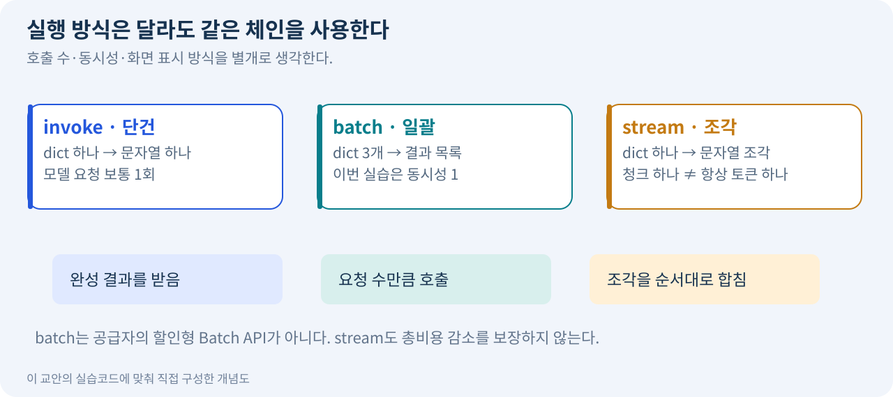

# 6차시. invoke·batch·stream과 선택 Groq 실습

> 처리 방식이 달라도 입력 계약은 유지된다



| 구성 | 시간 |
|---|---:|
| 처리 방식의 업무 필요 | 5분 |
| 호출 수·동시성·스트리밍 원리 | 20분 |
| batch·stream 실행 | 20분 |
| Groq 선택 설정·제한 해설 | 5분 |

## 하나의 체인을 세 가지 방식으로 사용한다

상담원이 문의 한 건을 처리할 때는 `invoke`가 단순하다. 여러 문의의 초안을 준비하려면 `batch`가 편리하다. 긴 답변을 완성되기 전에 화면에 보여주려면 `stream`을 사용할 수 있다. 세 방식이 서로 다른 모델을 학습시키는 것은 아니다. 같은 체인을 어떻게 실행하고 결과를 받을지의 차이다.

| 방식 | 입력 | 결과 | 모델 요청 수 |
|---|---|---|---|
| `invoke` | dict 하나 | 최종 문자열 하나 | 보통 1회 |
| `batch` | dict 목록 | 입력 순서에 대응하는 결과 목록 | 입력 수만큼 |
| `stream` | dict 하나 | 문자열 조각 반복자 | 보통 1회 |

LCEL의 `batch`는 공급자의 할인형 비동기 Batch API와 다르다. 목록을 넘겼다고 요청이 하나로 합쳐지는 것은 아니다. 기본 구현은 여러 요청을 병렬 처리할 수 있어 강의실 전체가 동시에 실행하면 계정 한도에 도달하기 쉽다. 실습 코드는 `max_concurrency=1`로 제한해 3건을 한 번에 하나씩 처리한다. 이는 조직의 모든 학생을 합산한 전역 제한은 아니다.

## 결과와 예외를 항목별로 다루기

`return_exceptions=True`를 사용하면 항목의 오류가 결과 목록의 예외 객체로 반환될 수 있다. 입력 목록 순서와 결과 목록 순서를 맞춰 어느 문의가 실패했는지 확인할 수 있다. 이 방식은 실패 항목을 알아보기 쉽지만 이미 시작된 다른 요청을 취소하는 전역 회로 차단기는 아니다. 한도 오류가 발생하면 추가 명령 실행을 멈추고 상태를 확인한다. 8차시 통합 코드는 한도 오류를 만났을 때 다음 행 호출을 중단하도록 별도 순차 루프를 둔다.

## 스트리밍이 빨라 보이는 이유

전체 답변이 완성되기 전에 일부를 보여주면 사용자는 진행 상황을 볼 수 있다. 이것이 전체 토큰 생성 시간이나 총비용이 줄었다는 의미는 아니다. 청크 하나가 항상 단어 또는 토큰 하나인 것도 아니다. 문자열 조각을 순서대로 붙이면 최종 텍스트를 구성할 수 있다.

파이프라인 중간에 전체 입력을 기다리는 함수가 있으면 스트리밍 시작이 지연될 수 있다. 이번 전처리 `RunnableLambda`는 모델 앞에서 짧게 실행된다. 모델 뒤에 완성 문장 전체를 필요로 하는 함수를 추가하면 조각 전달이 막힐 수 있다. 스트리밍 지원은 체인의 모든 구간을 살펴야 한다.

## 선택 실습: Groq로 바꾸기

Groq 실습은 반복 연습의 접근 비용을 줄이는 보조 경로다. OpenAI 기본 예제를 마친 뒤 선택적으로 사용한다. API 키와 모델 ID는 공급자마다 다르다. `ChatOpenAI`의 주소만 바꿔 모든 기능이 동일하다고 가정하지 않고 공식 `ChatGroq` 통합을 사용한다.

```bash
python -m pip install -r requirements-groq.txt
```

`.env`에서 `LLM_PROVIDER=groq`, `GROQ_API_KEY`, `GROQ_MODEL`을 설정한다. OpenAI로 돌아가려면 `LLM_PROVIDER=openai`로 명시적으로 바꾼다. 프로그램이 Groq 실패 후 OpenAI로 자동 전환하지 않는다. 무료 플랜도 요청·토큰 한도가 있으므로 수업 전에 실제 계정 한도를 확인한다.

## 실행환경·실행방법

```bash
python -m sessions.s06 --mock
python -m sessions.s06 --mock --stream
```

모의 일괄 실행은 고정 문자열 3개를 출력한다. 모의 스트리밍은 라이브러리의 가짜 채팅 모델이 고정 문자열을 나누어 출력한다. 실제 네트워크 지연을 재현하거나 공급자 속도를 측정한 결과가 아니다.

실제 실행은 `--mock`을 뺀다. 일괄 모드는 3회, `--stream` 모드는 1회다. 두 명령을 모두 실행하면 총 4회다. 스트리밍 도중 중단하려면 `Ctrl+C`를 사용한다. 중단 시 이미 처리된 토큰에 대한 비용이 발생할 수 있다.

다음 차시에는 실행 방식보다 프롬프트 설계의 차이에 집중해 같은 문의의 답변을 비교하고 결과를 파일에 남긴다.


## 차시 실행 코드

`sessions/s06.py`

```python
import argparse
from app.config import Settings
from app.providers import make_model, friendly_error
from app.pipeline import build_chain, load_cases


def main():
    parser = argparse.ArgumentParser()
    parser.add_argument("--mock", action="store_true")
    parser.add_argument("--stream", action="store_true")
    args = parser.parse_args()
    settings = Settings.read(args.mock)
    chain = build_chain(make_model(settings))
    inputs = [{"inquiry": c["inquiry"]} for c in load_cases()]
    print("실행:", settings.provider, settings.model)
    if args.stream:
        for chunk in chain.stream(inputs[0]):
            print(chunk, end="", flush=True)
        print()
    else:
        # batch는 공급자 Batch API가 아니다. 요청 3개, 동시성 1로 순차 처리한다.
        results = chain.batch(inputs, config={"max_concurrency": 1}, return_exceptions=True)
        for index, result in enumerate(results, 1):
            print(index, friendly_error(result) if isinstance(result, Exception) else result)

if __name__ == "__main__":
    try:
        main()
    except Exception as error:
        raise SystemExit(friendly_error(error))

```
