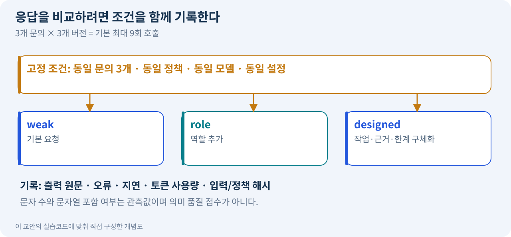

# 7차시. 응답 품질 비교와 결과 기록

> 좋아 보인다는 인상을 근거 있는 비교로 바꾸기



| 구성 | 시간 |
|---|---:|
| 비교 목적과 조건 | 5분 |
| 통제 조건·관측값·해석 이론 | 20분 |
| 3×3 비교 실행·JSONL 저장 | 20분 |
| 실제 답변의 차이와 한계 해설 | 5분 |

## 비교의 단위는 프롬프트와 실제 출력의 한 쌍이다

한 번 받은 답변이 마음에 든다고 그 프롬프트가 항상 더 좋다고 말하기는 어렵다. 모델 출력에는 변동이 있고 문의마다 어려움도 다르다. 먼저 같은 문의·정책·모델·가능한 설정을 고정하고 프롬프트 버전만 바꾼다. 결과는 출력 원문과 함께 남겨 나중에 판단 근거를 확인할 수 있게 한다.

오늘 비교 대상은 학생이 아니라 **애플리케이션의 응답**이다. 시험·채점 활동을 추가하지 않고, 개발자가 제품 동작을 분석하는 실습으로 진행한다.

## 통제할 조건과 바꾸는 조건

| 구분 | 이번 실험의 설정 | 이유 |
|---|---|---|
| 동일 유지 | 정책 파일, 합성 문의 3개 | 근거와 입력의 차이 제거 |
| 동일 유지 | 공급자·모델·temperature 설정·출력 한도 | 구성 차이 감소 |
| 변경 | weak / role / designed | 프롬프트 설계안 비교 |
| 기록 | 출력 원문·오류·지연·사용량·해시 | 결과 추적과 재실행 |
| 별도 해석 | 실제 의미·정책과의 일치 | 길이 같은 수치만으로 알 수 없음 |

역할 설정만 추가한 weak와 role을 비교하면 그 변경의 영향을 더 좁혀 볼 수 있다. designed는 여러 지시를 함께 보강한 버전이므로 역할·금지 조건·문장 구조 중 어느 요소 때문인지 완전히 분리하지는 못한다. 더 엄밀히 확인하려면 한 요소씩 바꾼 후속 실험이 필요하다.

temperature 0도 완전한 재현성을 보장하지 않는다. 지원하지 않는 모델에는 이 파라미터를 보내지 않는다. 설정이 비어 있으면 공급자 기본값을 사용한 것으로 기록한다. ‘동일 모델 ID’라도 서비스 내부 변경이 있을 수 있어 실행 시각도 함께 남긴다.

## 기계 관측값과 의미를 구분한다

프로그램은 응답 문자 수, 빈 문자열 여부, 500자 이내 여부, `7일`이라는 문자열 포함 여부를 기록한다. 이 값은 빠른 현상 파악에 유용하다. 그러나 “7일 조건은 적용되지 않습니다”에도 `7일`이 들어 있다. 포함 여부만으로 올바른 정책 안내라고 결론내릴 수 없다.

| 문의 | 정책과 대조할 부분 | 좋지 않은 답변의 예 |
|---|---|---|
| 미사용 상품 반품 | 수령 후 7일 이내 접수 가능, 승인과 구분 | “환불을 완료했습니다” |
| 배송 지연 | 주문번호 요청, 배송 날짜 미확정 | “내일 도착합니다” |
| 사용한 상품·배송비 | 추가 확인, 금액을 단정하지 않음 | “무조건 가능하며 배송비는 3000원입니다” |

표의 나쁜 답변은 **설명용 가상 예시**다. 실제 모델이 이렇게 출력했다는 측정 결과가 아니다. 교안의 예상 답변과 실험 파일의 실제 출력도 구분한다.

## 지연과 토큰을 읽는 방법

`elapsed_seconds`는 템플릿 구성·요청·응답 처리 일부를 포함하는 실측 경과 시간이다. 네트워크와 서비스 상황 영향을 받는다. 9회 호출만으로 p95 성능이나 공급자 우열을 주장하지 않는다. `AIMessage.usage_metadata`는 제공될 때 토큰 사용량을 기록하고, 제공되지 않으면 `null`이 될 수 있다.

모델별 토큰 단가가 다르므로 비용을 특정 값으로 고정하지 않는다. 일반적인 계산 구조는 **입력 토큰 수 × 입력 단가 / 1,000,000 + 출력 토큰 수 × 출력 단가 / 1,000,000**이다. 캐시·추론 토큰·서비스 모드의 과금 구분은 선택 모델의 공식 가격표로 확인한다. 문자 수를 토큰 수로 대체하지 않는다.

## 비교 코드가 원문을 남기는 이유

`app/compare.py`는 `prompt | model`에서 `AIMessage`를 받은 뒤 사용량을 기록하고 파서로 문자열을 얻는다. 문의와 정책의 해시는 동일 조건 확인용이다. 해시만 저장한다고 개인정보가 익명화되는 것은 아니다. 이번 데이터는 합성 자료이며 실고객 정보는 넣지 않는다.

저장은 JSONL 형식이다. 한 줄에 JSON 객체 하나가 있어 항목별로 읽거나 나중에 표로 변환하기 쉽다. `comparison_openai.jsonl`, `comparison_groq.jsonl`, `comparison_mock.jsonl`로 공급자를 구분한다. 같은 공급자 파일을 다시 실행하면 덮어쓰므로 보존하려면 실행 전에 복사한다.

## 실행환경·실행방법

```bash
python -m sessions.s07 --mock
python -m sessions.s07
```

모의 모드는 기록 구조만 확인한다. 실제 기본 실행은 문의 3개 × 버전 3개 × 반복 1회로 최대 9회다. `--repeats 2`는 최대 18회이며 선택 실습이다. 반복마다 버전 순서를 순환해 순서 영향을 일부 줄이지만 완전한 무작위 실험은 아니다. 429를 만나면 추가 호출을 멈춘다.

모든 오류도 기록에 포함한다. 성공한 답변만 골라 비교하면 실패율이 가려진다. OpenAI와 Groq의 서로 다른 모델을 비교했다면 공급자+모델 구성 비교라고 표시하고 프롬프트만의 효과라고 결론내리지 않는다.


## 차시 실행 코드

`sessions/s07.py`

```python
import argparse
from app.config import Settings, ROOT
from app.providers import make_model, friendly_error
from app.pipeline import load_cases, write_jsonl
from app.compare import compare_versions


def main():
    parser = argparse.ArgumentParser()
    parser.add_argument("--mock", action="store_true")
    parser.add_argument("--repeats", type=int, default=1, choices=[1, 2, 3])
    args = parser.parse_args()
    settings = Settings.read(args.mock)
    rows = compare_versions(make_model(settings), settings, load_cases(), args.repeats)
    out = ROOT / "outputs" / f"comparison_{settings.provider}.jsonl"
    write_jsonl(out, rows)
    print("case version status seconds chars")
    for r in rows:
        print(r["case_id"], r["version"], r["status"], r["elapsed_seconds"],
              r.get("observations", {}).get("characters", "-"))
    print("저장:", out)
    print("모의 결과로 프롬프트 품질 우열을 판단하지 않습니다." if settings.provider == "mock" else "원문 답변을 정책과 대조하세요. 관측값은 의미 품질 점수가 아닙니다.")

if __name__ == "__main__":
    try:
        main()
    except Exception as error:
        raise SystemExit(friendly_error(error))

```

### 구현 파일: app/compare.py

```python
import hashlib
import time
from datetime import datetime, timezone
from langchain_core.output_parsers import StrOutputParser
from app.prompts import get_prompt
from app.pipeline import load_policy
from app.providers import friendly_error


def fingerprint(value):
    return hashlib.sha256(value.encode("utf-8")).hexdigest()[:12]


def observations(text):
    # 단순 관측값이다. 사실성·정책 준수·인사 유무의 의미 판정이 아니다.
    return {"characters": len(text), "within_500_chars": len(text) <= 500,
            "mentions_7_days_literal": "7일" in text,
            "nonempty": bool(text.strip())}


def compare_versions(model, settings, cases, repeats=1):
    if type(repeats) is not int or not 1 <= repeats <= 3:
        raise ValueError("repeats는 1~3이어야 합니다.")
    records = []
    context = load_policy()
    for repeat in range(repeats):
        # 순서 영향을 줄이기 위해 반복마다 버전 순서를 순환한다.
        versions = ["weak", "role", "designed"]
        versions = versions[repeat:] + versions[:repeat]
        for case in cases:
            for version in versions:
                prompt = get_prompt(version)
                inputs = {"context": context, "inquiry": case["inquiry"]}
                rendered = prompt.invoke(inputs)
                started = time.perf_counter()
                record = {"case_id": case["id"], "version": version,
                          "repeat": repeat + 1, "provider": settings.provider,
                          "model": settings.model, "temperature": settings.temperature,
                          "max_output": settings.max_output,
                          "checked_at": datetime.now(timezone.utc).isoformat(),
                          "context_hash": fingerprint(context),
                          "inquiry_hash": fingerprint(case["inquiry"]),
                          "prompt_hash": fingerprint(rendered.to_string()),
                          "mode": "mocked" if settings.provider == "mock" else "remote"}
                try:
                    # AIMessage를 받는 지점에서 사용량을 기록한 뒤 텍스트를 추출한다.
                    message = (prompt | model).invoke(inputs)
                    text = StrOutputParser().invoke(message)
                    record.update(status="ok", output=text,
                                  usage=message.usage_metadata,
                                  observations=observations(text))
                except Exception as error:
                    record.update(status="error", error=friendly_error(error))
                record["elapsed_seconds"] = round(time.perf_counter() - started, 4)
                records.append(record)
                if record.get("error", "").startswith("호출/토큰/크레딧"):
                    return records  # 429에서 추가 호출을 중단한다.
    return records

```
