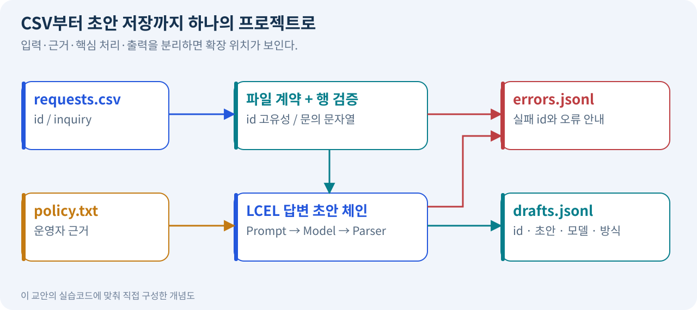

# 8차시. CSV 입력부터 답변 초안 저장까지 통합하기

> 오늘 배운 부품을 작은 프로젝트로 완성하기



| 구성 | 시간 |
|---|---:|
| 전체 구조·인터페이스 연결 | 5분 |
| CSV 계약·오류 격리·확장 이론 | 15분 |
| 통합 실행·실패 행 처리 | 25분 |
| 결과·한계·다음 수업 연결 | 5분 |

## 작은 프로젝트의 최소 완결 흐름

실제 업무에서는 입력이 함수 안의 문자열 상수로만 들어오지 않는다. CSV, API, UI 같은 경계에서 데이터를 받아 처리하고 결과를 다시 저장해야 한다. 오늘은 이미 배운 Python 파일 처리와 LCEL을 연결해 CSV 문의 목록을 읽고 초안을 JSONL 파일로 저장한다.

입력 수집 방식은 이후 FastAPI로 바뀔 수 있지만 핵심 체인은 유지할 수 있다. `build_chain(model).invoke({"inquiry": ...})`라는 호출 계약이 있기 때문이다. 아직 API 서버나 DB를 추가하지 않아도 외부 경계와 핵심 로직을 나누면 확장 위치가 선명해진다.

## 파일 형식은 인터페이스다

| 파일 | 계약 | 설계 이유 |
|---|---|---|
| `requests.csv` | `id,inquiry` 헤더, 고유 id | 결과와 원문 행 연결 |
| `policy.txt` | 운영자가 관리하는 UTF-8 정책 | 고객 입력과 근거 분리 |
| `drafts.jsonl` | id·초안·공급자·모델·실행 방식 | 결과 후속 활용 |
| `errors.jsonl` | id·오류 안내 | 실패 원인과 재처리 대상 확인 |

Windows Excel이 만든 CSV에는 BOM이 있을 수 있어 `utf-8-sig`로 읽는다. `csv.DictReader`는 헤더를 키로 사용한다. 쉼표가 포함된 문의는 CSV 규칙에 따라 큰따옴표로 감싸야 한다. 직접 `split(",")`하면 문의 안의 쉼표 때문에 칼럼이 깨질 수 있다.

id가 비거나 중복되면 어느 고객의 결과인지 혼동할 수 있으므로 파일 계약 오류로 중단한다. 문의가 빈 행은 해당 항목만 오류로 기록한다. ‘파일 전체를 읽을 수 없는 오류’와 ‘한 항목이 잘못된 오류’를 다른 수준에서 처리하는 것이다.

## 하나의 실패가 다른 정상 행을 가리지 않게 한다

통합 프로그램은 한 행씩 체인을 호출하고 성공 결과와 오류를 따로 모은다. 빈 문의는 Python 검증에서 멈추므로 모델 호출이 없다. 일시적 연결 실패도 행 오류로 기록한다. 429는 계정 전체 한도일 수 있어 다음 행 호출을 중단한다. 이때 선택한 행 수와 성공+오류 수가 다를 수 있다. 남은 행은 처리되지 않았으므로 429 원인을 해결한 뒤 필요한 대상만 다시 실행한다.

한 번 더 실행하면 새 시간 이름의 폴더를 만들어 이전 초안을 덮어쓰지 않는다. 다만 실고객 서비스를 만들 때는 중복 실행·발송 방지, 원자적 저장, 인증, 접근 통제, 요청 제한을 추가해야 한다. 오늘은 자동 발송 자체가 없으므로 결과를 검토하는 단계에서 끝난다.

## 실습 순서

먼저 `data/requests.csv`의 3개 합성 문의를 살펴본다. 이어 `read_requests()`로 행을 읽고 id 계약을 확인한다. 모델과 체인은 반복문 밖에서 한 번 구성한다. 각 행에는 `inquiry`만 전달한다. 마지막으로 정상·오류 결과를 서로 다른 JSONL 파일에 저장한다.

실습 코드는 완성된 모듈을 숨겨 두고 사용하는 구조가 아니다. 앞 차시에서 작성한 설정·프롬프트·전처리 함수를 그대로 재사용한다. 각 차시 본문 뒤에 해당 구현을 함께 제공하므로 파일을 열어 전체 흐름을 따라갈 수 있다.

## 실행환경·실행방법

```bash
python -m sessions.s08 --mock
python -m sessions.s08 --mock --input data/requests_with_error.csv
```

첫 실행은 `성공 3 / 오류 0 / 선택 3`, 둘째는 `성공 2 / 오류 1 / 선택 3`을 출력해야 한다. `outputs/run_실행시각/` 안에서 `drafts.jsonl`과 `errors.jsonl`을 연다. 둘째 실행의 오류 id는 `BAD01`이며, 정상 두 행은 결과 파일에 남는다.

실제 호출은 먼저 한 건만 처리해 설정을 확인한다.

```bash
python -m sessions.s08 --limit 1
python -m sessions.s08
```

두 명령을 모두 실행하면 정상 기준 최대 4회다. 기본 통합 명령 하나만 실행하면 3회다. `--limit`은 1~5이고 CSV는 수업용으로 최대 100행까지만 읽는다. 이 제한은 비용 예측을 돕는 애플리케이션 설정이며 공급자 한도를 대체하지 않는다.

## 완성 흐름을 다시 읽기

문의 문자열은 Python 검증을 통과한 뒤 역할 있는 메시지가 된다. 메시지가 모델에 전달되고 `AIMessage`가 돌아오면 파서가 문자열을 추출한다. 저장 단계가 id와 설정을 묶어 결과를 남긴다. **데이터가 어떤 타입으로 바뀌며 어디에서 외부 호출이 발생하는지**를 알면 오류의 위치와 확장 방법을 설명할 수 있다.

내일 11월 18일에는 같은 문의·정책·결과 기록 구조를 활용해 단계적 문제 해결 프롬프트를 비교한다. 모델의 비공개 내부 사고를 노출하는 것과 사용자에게 필요한 간결한 근거·검증 요약을 제공하는 것은 구분한다. Structured Output, 실제 도구 호출, RAG, LangGraph는 이후 날짜에 차례로 추가한다.


## 차시 실행 코드

`sessions/s08.py`

```python
import argparse
from datetime import datetime
from app.config import ROOT, Settings
from app.providers import make_model, friendly_error
from app.pipeline import build_chain, read_requests, write_jsonl


def main():
    parser = argparse.ArgumentParser()
    parser.add_argument("--mock", action="store_true")
    parser.add_argument("--input", type=str, default=str(ROOT / "data/requests.csv"))
    parser.add_argument("--limit", type=int, default=3, choices=range(1, 6))
    args = parser.parse_args()
    requests = read_requests(args.input)[:args.limit]
    settings = Settings.read(args.mock)
    chain = build_chain(make_model(settings))
    results, errors = [], []
    for row in requests:
        try:
            draft = chain.invoke({"inquiry": row["inquiry"]})
            results.append({"id": row["id"], "draft": draft, "provider": settings.provider,
                            "model": settings.model, "mode": "mocked" if args.mock or settings.provider == "mock" else "remote"})
        except Exception as error:
            errors.append({"id": row["id"], "error": friendly_error(error)})
            if getattr(error, "status_code", None) == 429:
                break  # 공급자 한도에서는 이후 항목도 호출하지 않는다.
    run = datetime.now().strftime("%Y%m%d_%H%M%S_%f")
    folder = ROOT / "outputs" / f"run_{run}"
    write_jsonl(folder / "drafts.jsonl", results)
    write_jsonl(folder / "errors.jsonl", errors)
    print(f"성공 {len(results)} / 오류 {len(errors)} / 선택 {len(requests)}")
    print("결과:", folder)
    print("초안을 검토한 뒤 사용하세요.")

if __name__ == "__main__":
    try:
        main()
    except Exception as error:
        raise SystemExit(friendly_error(error))

```
